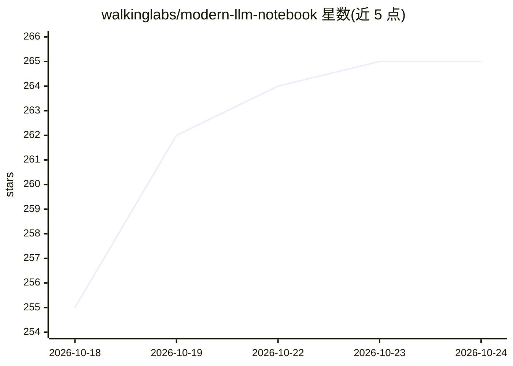

# walkinglabs/modern-llm-notebook

⭐ 265 · Jupyter Notebook · NOASSERTION · 推送 2026-10-01 · [GitHub](https://github.com/walkinglabs/modern-llm-notebook) · [官网](https://walkinglabs.github.io/modern-llm-notebook/) · 组织维护 · 中文 README

**从零实现现代 LLM 的实践教程：PyTorch 可运行笔记本与训练实验**

面向学习者的双语 LLM 课程，以逐步拆解的 Jupyter 笔记本加可运行训练脚本组织：从 BPE 分词器训练、数据清洗（Data-Juicer）、64M 级 DotLM Dense 模型预训练、SFT 到 lm-evaluation-harness 评测，覆盖 RoPE、GQA、MLA、MoE、LoRA、量化与推理系统等主题。中文版为源版本，附英文镜像与在线阅读器，支持 Colab、ModelScope、AMD Radeon Cloud 在线运行。实验记录含 AMD MI300X 单卡训练与完整基准分数，未提供公开权重下载入口。

## 筛选速览

| 维度 | 判定 | 备注 |
|---|---|---|
| AI 角色 | `ai-knowledge` | 知识聚合/清单类 |
| 许可风险 | `none` | NOASSERTION |
| 部署形态 | `library` | 以包/库形式分发 |
| 模型依赖 | — | README 未给出锁定关系 |
| 硬件要求 | — | 无带数字的原话,不猜 |
| 安装摩擦 | `medium` | 含编译或系统依赖之一 |
| 成熟度 | `idea` | |

## 能力要点

- BPE 分词器训练到 DotLM 64M 级预训练与 SFT 的完整训练路径
- 61.55M 模型在 MI300X 上的训练与八项基准评测记录（含复现脚本）
- 覆盖 MoE、工具调用、对齐、蒸馏、量化、推理系统等扩展主题
- 中英双语笔记本，支持 Colab/ModelScope/AMD 云端在线运行

## 适用场景

- 跟着笔记本从零理解 Transformer 与 LLM 训练各环节
- 复现小规模 LLM 预训练、SFT 与评测实验
- 在无本地 GPU 的情况下通过 Colab 或 ModelScope 在线运行课程代码

## 场景标签

 · 领域:AI 教育/LLM 训练

## 证据(README 行号)

> L7:  Learn modern LLMs from scratch, one detailed example and experiment at a time.
> L100: - **Detailed from-scratch teaching.** Build the core components in PyTorch through intuition, hand calculation, im
> L104: This is an educational reference: notebooks explain each mechanism, while the training scripts and reports documen

## 星数曲线

2026-10-18 255 → 2026-10-24 265（+10）

---
*卡片 v1 · prompt 1.4 · 生成 2026-10-22 · 置信度 mid · 依据 README sha `fdebddcf692c` · [字段定义](../../DATASET.md)*
