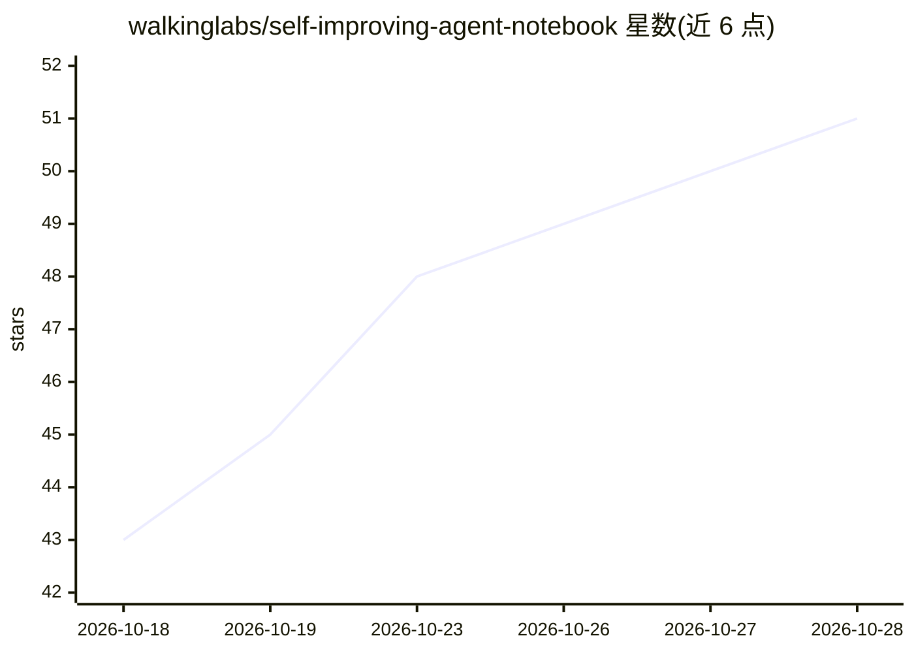

# walkinglabs/self-improving-agent-notebook

⭐ 51 · Jupyter Notebook · 推送 2026-10-01 · [GitHub](https://github.com/walkinglabs/self-improving-agent-notebook) · [官网](https://walkinglabs.github.io/self-improving-agent-notebook/) · 组织维护 · 中文 README

**斯坦福 CS329A 配套的 17 讲自改进 Agent 可运行笔记本课程**

将斯坦福 CS329A（AI Agents, 2025 秋）课程讲义转化为 17 个可运行 Jupyter Notebook：从零实现 agent 循环、验证器、ReAct、UCT 树搜索、GRPO 更新、进化循环、分层记忆与评测框架，每个笔记本遵循“直觉→手算→实现→实验”流程，模型相关实验需配置 OpenAI 兼容端点与 API key。另提供 React/Vite 在线阅读器、每讲中英双语学习笔记与 39 篇论文下载脚本。面向系统学习 agent 核心算法的学习者，推荐 Python 3.10+、16GB RAM，多数笔记本可在 CPU 运行。

## 筛选速览

| 维度 | 判定 | 备注 |
|---|---|---|
| AI 角色 | `ai-knowledge` | 知识聚合/清单类 |
| 许可风险 | `none` | — |
| 部署形态 | `None` |  |
| 模型依赖 | — | README 未给出锁定关系 |
| 硬件要求 | — | 无带数字的原话,不猜 |
| 安装摩擦 | `low` | 无编译、无系统依赖或容器化 |
| 成熟度 | — | 结构信号不足 |

## 能力要点

- 17 个笔记本覆盖 agent 循环、验证器、树搜索、GRPO、进化、记忆与评测
- 每讲遵循“直觉→手算→实现→实验”契约，不依赖框架
- 支持任意 OpenAI 兼容端点做真实模型实验
- 中英双语笔记本与每讲学习笔记，附论文下载脚本

## 适用场景

- 系统学习现代 AI agent 的核心算法并亲手实现
- 按课程路径从单次 LLM 调用进阶到自改进 agent
- 配合论文阅读理解 agent 研究各环节的作用

## 场景标签

`教程课程` · 领域:学习与行业

## 证据(README 行号)

> L31: In 17 notebooks you build, **from scratch**, every core algorithm behind modern AI agents — and you trace each one
> L246: The curriculum mirrors the syllabus of Stanford's CS329A: AI Agents

## 星数曲线

2026-10-18 43 → 2026-10-28 51（+8）

---
*卡片 v1 · prompt 1.4 · 生成 2026-10-25 · 置信度 high · 依据 README sha `a59129e63a32` · [字段定义](../../DATASET.md)*
