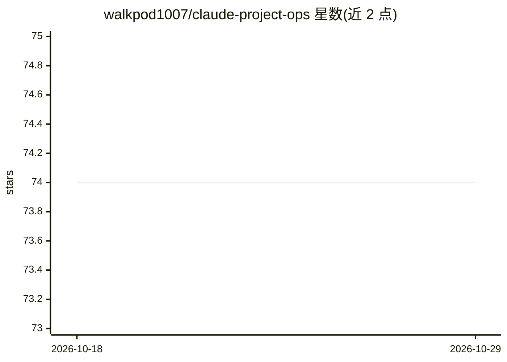

# walkpod1007/claude-project-ops

⭐ 74 · MIT · 推送 2026-09-09 · [GitHub](https://github.com/walkpod1007/claude-project-ops) · 个人维护 · 中文 README

**让中阶模型接管项目运作的可移植调度规则模板**

面向 Claude Code 及任何以 CLAUDE.md 入口文件加子代理/派工机制构建的 harness 的运维规则集：将高阶模型的调度判断（何时派工、何时升级模型、何时停下询问、如何验证）写成可执行规则，使 Sonnet/Haiku 级模型可运行项目全程。规则来自一次真实长跑多代理部署，每条附判定测试与正反例。安装方式为复制 ops/ 与模板文件进项目并按三步部署；README 明示其不解决品味判断与问题定义的模糊性，环境相关细节需落地后重新查证。

## 筛选速览

| 维度 | 判定 | 备注 |
|---|---|---|
| AI 角色 | `ai-ecosystem` | LLM/agent 周边工具 |
| 许可风险 | `permissive` | MIT |
| 部署形态 | `None` |  |
| 模型依赖 | — | README 未给出锁定关系 |
| 硬件要求 | — | 无带数字的原话,不猜 |
| 安装摩擦 | `low` | 无编译、无系统依赖或容器化 |
| 成熟度 | — | 结构信号不足 |

## 能力要点

- 规则覆盖派工、升级、停问、验证与规则自身修订
- 设计为不依赖顶级模型，中阶模型可跑
- 每条规则附判定测试与一正一反例
- 源自真实多代理部署，实例为去识别化的真实事件

## 适用场景

- 用中阶模型在 Claude Code 中稳定运行项目全程
- 为多代理部署提供派工与升级的调度规则层
- 在预算或供应商变动后保留原有的执行纪律

## 场景标签

`多智能体` `提示工程` · 领域:Agent 开发

## 证据(README 行号)

> L9: Works with Claude Code, or any harness built around a `CLAUDE.md`-style entry file plus a subagent/dispatch mechanis
> L5: This repo started in July 2026 as a race against a deadline: the top judgment-tier model of the day was announced to
> L36: - **No dependency on a frontier-tier model** — the whole loop is designed to run on a mid-tier model. The cases whe

## 星数曲线

2026-10-18 74 → 2026-10-29 74（+0）

---
*卡片 v1 · prompt 1.4 · 生成 2026-10-24 · 置信度 high · 依据 README sha `f3967d2c16b0` · [字段定义](../../DATASET.md)*
