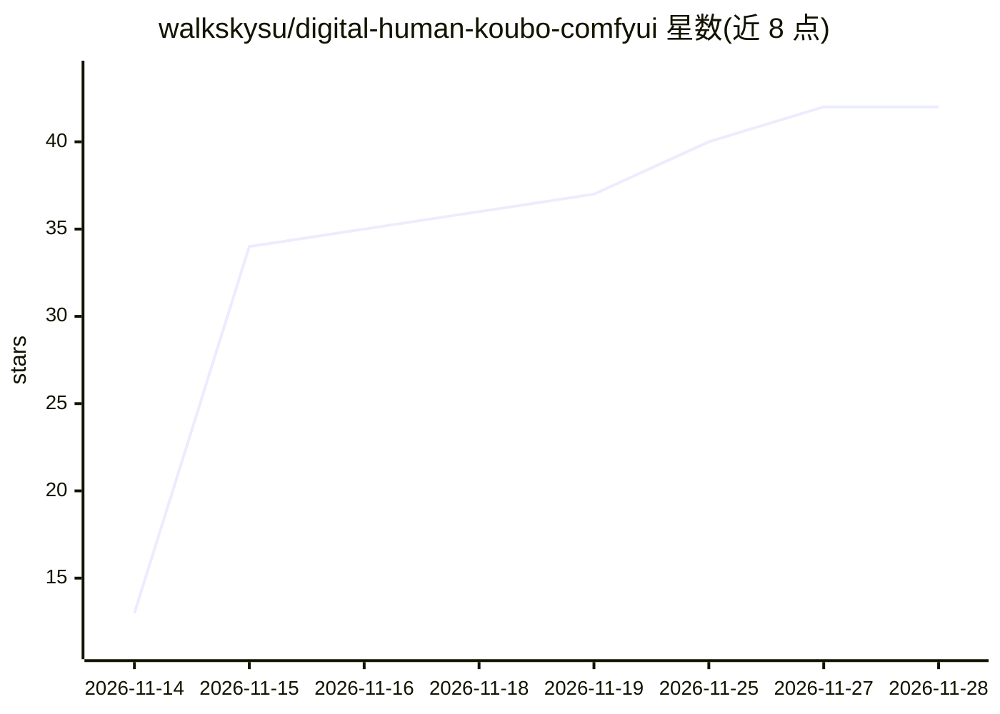

# walkskysu/digital-human-koubo-comfyui

⭐ 42 · TypeScript · MIT · 推送 2026-11-16 · [GitHub](https://github.com/walkskysu/digital-human-koubo-comfyui) · 个人维护 · 中文 README

**一张照片本地生成 AI 数字人口播成片的 Agent Skill**

面向可执行命令的 AI Agent（如 Claude Code）的技能包（SKILL.md 格式）：用户说一句话，Agent 通过本地 ComfyUI 的 HTTP API 完成写稿、Qwen3-TTS 声音克隆、MiniMax H3 按最终配音生成对口型画面、场景图、B-roll、配乐与剪辑，输出五种风格的成片，全程不调云端接口。需 24 GB 显存 NVIDIA 显卡（实测 RTX 3090），40 秒成片约占 40–70 分钟 GPU 时间；另保留原项目的云端 Renoise MCP 路线。渲染依赖 Remotion（其许可对较大公司收费）。

## 筛选速览

| 维度 | 判定 | 备注 |
|---|---|---|
| AI 角色 | `ai-native` | 本体是模型或模型工具 |
| 许可风险 | `permissive` | MIT |
| 部署形态 | `None` |  |
| 模型依赖 | — | README 未给出锁定关系 |
| 硬件要求 | `gpu-24g` | |
| 安装摩擦 | `medium` | 含编译或系统依赖之一 |
| 成熟度 | — | 结构信号不足 |

## 能力要点

- 先配音再出画面：口型照最终克隆声音生成，支持事后换声不跑偏
- 每句配音自动回听比对、念错只重配该句；分段生成后统一音画对齐
- 5 种剪辑风格 + 48 个包装组件，Agent 按内容推荐风格
- 支持多主播接力、多语言、persona.json 自定义主播

## 适用场景

- 在本地显卡上不花积分制作口播视频，不上传照片与录音
- 做财经解说、带货花字口播、发布解读等短视频
- 换用自己的脸和声音生成固定数字人主播

## 场景标签

`语音合成` `图像生成` `视频生成` `AI 写作` · 领域:内容生成

## 证据(README 行号)

> L3: **一张照片 + 一句话 → 一条对好口型的数字人口播成片，全程在你自己的显卡上生成。**
> L123: |**生成**|不用写提示词、不用连 ComfyUI 节点。Agent 写稿、克隆声音、照着配音生成对好口型的主播画面，按需补场景图、B-roll 和配乐。主播的脸、服装、声音存在 `persona.json`，每条片子都是同一
> L152: 本地路线是**先配音，再出画面**：嘴型是照着最终音频生成的，所以用克隆声音口型也准，事后不用换声音。全部模型都跑在你的 ComfyUI 里，脚本通过它的本地 HTTP API（默认 `http://127.0.0.1:8188

## 星数曲线

2026-11-14 13 → 2026-11-28 42（+29）

---
*卡片 v1 · prompt 1.4 · 生成 2026-11-18 · 置信度 high · 依据 README sha `ab7ecae226fe` · [字段定义](../../DATASET.md)*
