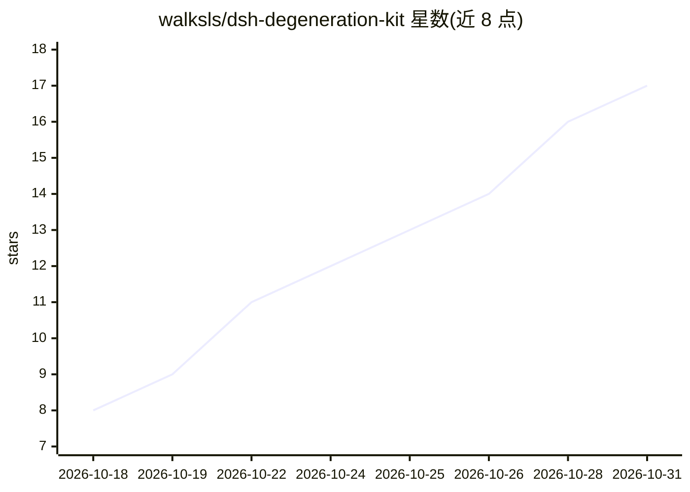

# walksls/dsh-degeneration-kit

⭐ 17 · JavaScript · MIT · 推送 2026-10-28 · [GitHub](https://github.com/walksls/dsh-degeneration-kit) · 个人维护 · 中文 README

**DSH 插件套件：折叠退化思考块并按水位自动压缩上下文**

面向 DSH 宿主的两个插件：thinking-guard 在 pre-step 时把复读/退化 reasoning 块从模型可见历史折叠（含急停阀与轮换判据 rotationGuard）；dsh-auto-checkpoint 到 token 水位自动压缩或换新会话，先落任务检查点，压缩失败含退避重试与落档两层新鲜度判据。两者联动形成闭环，README 声明缺一会漏。验证版本为 DSH 0.2.1-rc.2，自述依赖 DSH 内部服务、大版本升级可能失效，且未在规模化环境验证。不解决跨会话长期记忆与 token 单价问题。

## 筛选速览

| 维度 | 判定 | 备注 |
|---|---|---|
| AI 角色 | `ai-ecosystem` | LLM/agent 周边工具 |
| 许可风险 | `permissive` | MIT |
| 部署形态 | `None` |  |
| 模型依赖 | — | README 未给出锁定关系 |
| 硬件要求 | — | 无带数字的原话,不猜 |
| 安装摩擦 | `low` | 无编译、无系统依赖或容器化 |
| 成熟度 | `idea` | |

## 能力要点

- thinking-guard 折叠退化 reasoning 块并当场急停，含 A/B 两型复读判据
- dsh-auto-checkpoint 按水位压缩或换会话，压缩前落档任务状态
- 阈值可经浮动面板运行时调整，无需重启
- 自述实测单会话累计 23.2 亿 token 仍保持 24% 上下文占用

## 适用场景

- 长会话 agent 任务中防止模型陷入复读空转
- 控制上下文无限堆积、按水位自动压缩
- 在两次压缩之间持续清理被污染的思考块

## 场景标签

`Agent 记忆` · 领域:Agent 开发

## 证据(README 行号)

> L10: > - **少产生** —— `thinking-guard`：把退化的思考块从模型可见的历史里**折叠**掉，不让它每轮重放；
> L11: > - **清库存** —— `dsh-auto-checkpoint`：到水位**压缩**（把已经累积的污染整体清掉），或**换一个新会话**。
> L48: |**`thinking-guard`**|把退化的思考块从**模型可见的历史**里折叠掉|**当场**（下一次 pre-step，趁它还没被反复回传）|

## 星数曲线

2026-10-18 8 → 2026-10-31 17（+9）

---
*卡片 v1 · prompt 1.4 · 生成 2026-10-30 · 置信度 high · 依据 README sha `b0d84ce78d53` · [字段定义](../../DATASET.md)*
