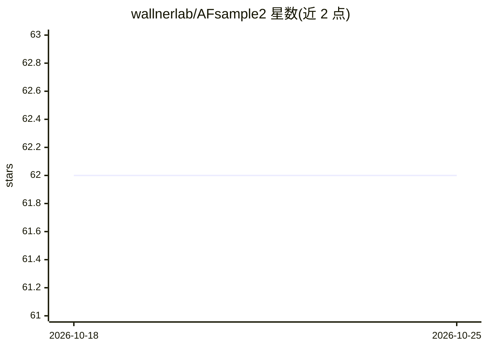

# wallnerlab/AFsample2

⭐ 62 · Jupyter Notebook · Apache-2.0 · 推送 2026-10-01 · [GitHub](https://github.com/wallnerlab/AFsample2) · 组织维护

**基于 AF2 的蛋白质构象集合生成与状态识别系统**

基于 AlphaFold2 的蛋白质结构预测系统，通过对 MSA 采样与扰动等方式诱导构象多样性，为给定蛋白序列生成多样的构象集合，并提供构象多样性分析与状态识别脚本。支持 Monomer/Multimer 模式下 AFvanilla、AFsample、AFsample2、SPEACH_AF、MSAsubsampling 等方法的运行组合。以 Docker/Apptainer 容器为主要运行方式，也可手动用 Miniconda 环境从源码安装，需自行准备 AlphaFold 序列数据库。附带论文数据与复现脚本。

## 筛选速览

| 维度 | 判定 | 备注 |
|---|---|---|
| AI 角色 | `ai-native` | 本体是模型或模型工具 |
| 许可风险 | `permissive` | Apache-2.0 |
| 部署形态 | `self-host` | docker 或自建部署 |
| 模型依赖 | — | README 未给出锁定关系 |
| 硬件要求 | — | 无带数字的原话,不猜 |
| 安装摩擦 | `low` | 无编译、无系统依赖或容器化 |
| 成熟度 | — | 结构信号不足 |

## 能力要点

- 多种方法（AFsample2/SPEACH_AF/MSAsubsampling/AFvanilla）可选的构象集合生成
- 支持 Monomer 与 Multimer 模式
- 构象多样性分析与状态识别（聚类）脚本
- 提供 Docker/Apptainer 容器镜像

## 适用场景

- 为一条蛋白序列生成多个构象状态的结构集合
- 对 AF2 输出模型做多样性分析与状态识别
- 复现论文中的数据与图表

## 场景标签

`科研工具` · 领域:学习与行业

## 证据(README 行号)

> L7: AFsample2 is a generative protein structure prediction system based on AF2 that is able to induce significant confor
> L2: Introducing a way to induce diversity in the AF2 ensemble by spanning the conformational ensemble and identifying po

## 星数曲线

2026-10-18 62 → 2026-10-25 62（+0）

---
*卡片 v1 · prompt 1.4 · 生成 2026-10-24 · 置信度 high · 依据 README sha `ae1f7a04b998` · [字段定义](../../DATASET.md)*
