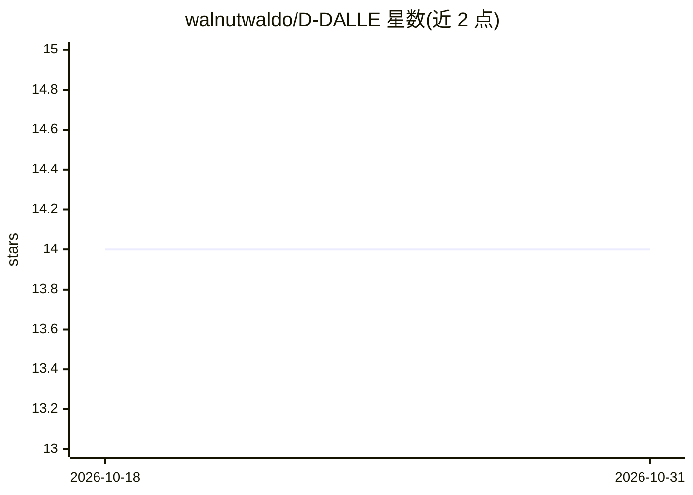

# walnutwaldo/D-DALLE

⭐ 14 · TypeScript · MIT · 推送 2026-07-22 · [GitHub](https://github.com/walnutwaldo/D-DALLE) · [官网](https://ddalle.xyz) · 个人维护

**链上 AI 艺术悬赏市场：悬赏求图、AI 生成应征并铸 NFT**

部署在 Klaytn 主网的去中心化艺术市场应用（ddalle.xyz），由智能合约构成双边市场：赞助方提交图像描述并设置悬赏，应征方使用平台提供的免费 DALL-E 2 界面（底层为 Stability AI 的 Stable Diffusion）生成作品应征，赞助方从中选一件并支付悬赏；获胜作品同时铸造为 NFT，可在 OpenSea 收录页查看。面向普通用户与创作者，无需本地安装，直接访问网站使用。

## 筛选速览

| 维度 | 判定 | 备注 |
|---|---|---|
| AI 角色 | `ai-native` | 本体是模型或模型工具 |
| 许可风险 | `permissive` | MIT |
| 部署形态 | `None` |  |
| 模型依赖 | — | README 未给出锁定关系 |
| 硬件要求 | — | 无带数字的原话,不猜 |
| 安装摩擦 | `low` | 无编译、无系统依赖或容器化 |
| 成熟度 | — | 结构信号不足 |

## 能力要点

- 智能合约构成的双边艺术悬赏市场
- 应征方通过免费 DALL-E 2 界面生成作品（底层为 Stable Diffusion）
- 获胜作品铸造 NFT 并可在 OpenSea 查看
- 已部署于 Klaytn 主网

## 适用场景

- 为演示或网站快速征集符合描述的定制图像
- 用 AI 生成作品参与悬赏获取报酬
- 将 AI 艺术作品以 NFT 形式收藏

## 场景标签

`图像生成` · 领域:内容生成

## 证据(README 行号)

> L2: D-DALLE stands for Decentralized DALL-E. This app is deployed live at ddalle.xyz on Klaytn mainnet.
> L3: The AI used in this work is Stable Diffusion, an open-source project created by Stability AI.
> L28:  Proposers generate art using our free DALL-E 2 interface which the sponsor gets to choose from. If a proposer's pi

## 星数曲线

2026-10-18 14 → 2026-10-31 14（+0）

---
*卡片 v1 · prompt 1.4 · 生成 2026-10-31 · 置信度 high · 依据 README sha `71d0dc35faee` · [字段定义](../../DATASET.md)*
