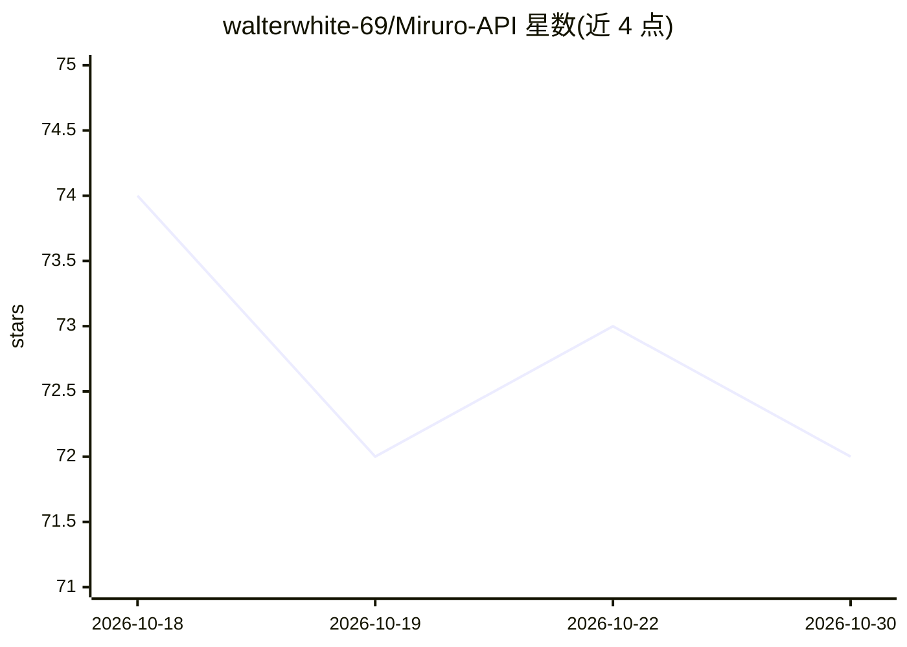

# walterwhite-69/Miruro-API

⭐ 72 · Python · 推送 2026-07-03 · [GitHub](https://github.com/walterwhite-69/Miruro-API) · 个人维护

**绕过 Miruro 加密管道的动漫元数据与 M3U8 流地址 Python API**

逆向 Miruro 前后端 secure/pipe 加密隧道的原生 Python FastAPI 后端：用 curl_cffi 模拟 Chrome TLS 指纹并构造 same-origin 头绕过 Cloudflare，以直接 REST 端点提供动漫搜索过滤（AniList 元数据）、合集浏览、详情、多 provider 剧集列表、M3U8/HLS 直链及片头片尾时间戳，无需无头浏览器。部署限制：不可部署于 Vercel/Render 等 PaaS（数据中心 IP 被 Cloudflare 拦截），需 VPS 或本地运行。声明仅供教育与研究用途。README 中无任何 AI 功能实现，主题标签中的 ai 仅为仓库标签。

## 筛选速览

| 维度 | 判定 | 备注 |
|---|---|---|
| AI 角色 | `ai-enhanced` | 去掉 AI 部分产品仍成立 |
| 许可风险 | `none` | — |
| 部署形态 | `library` | 以包/库形式分发 |
| 模型依赖 | — | README 未给出锁定关系 |
| 硬件要求 | — | 无带数字的原话,不猜 |
| 安装摩擦 | `low` | 无编译、无系统依赖或容器化 |
| 成熟度 | — | 结构信号不足 |

## 能力要点

- curl_cffi 模拟 Chrome TLS 指纹绕过 Cloudflare 检测
- 3 步取流：剧集列表→直链端点→任意 HLS 播放器播放
- 每条结果含 20+ 字段的 AniList 元数据与多 provider 剧集映射
- 纯异步 HTTP 请求，不依赖无头浏览器/Selenium

## 适用场景

- 为自建动漫站点后端获取搜索、详情与流媒体地址
- 在播放器中直接拉取 M3U8/HLS 链接与字幕
- 研究 Miruro 加密管道与 Cloudflare 防护机制

## 场景标签

 · 领域:流媒体/动漫数据 API

## 证据(README 行号)

> L21: Miruro's frontend communicates with its backend through a `secure/pipe` tunnel that base64-encodes, gzip-compresses
> L27: 5. **Get M3U8 streaming URLs** for any episode

## 星数曲线

2026-10-18 74 → 2026-10-30 72（-2）

---
*卡片 v1 · prompt 1.4 · 生成 2026-10-24 · 置信度 low · 依据 README sha `11720dfba790` · [字段定义](../../DATASET.md)*
