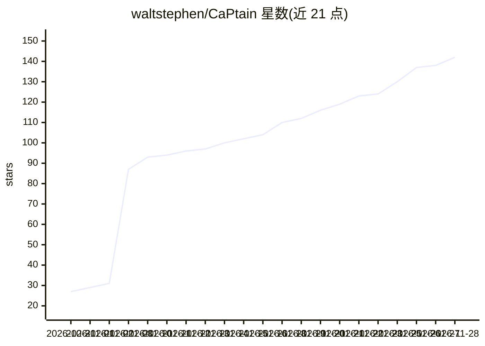

# waltstephen/CaPtain

⭐ 142 · Python · MIT · 推送 2026-11-20 · [GitHub](https://github.com/waltstephen/CaPtain) · 组织维护

**面向机器人研究者：代码即策略模型的训练与评测全流程**

CaPtain 通过 SFT 与 RL 后训练一个小型开源视觉语言模型（Qwen3.5-4B），使其成为 code-as-policy 机器人智能体：以 Python 调用 22 项低层感知与运动原语控制机器人，并自主判断任务完成。仓库提供 CaPtain-Harness 沙箱执行环境（支持 LIBERO 系列及 RoboTwin 2.0、RoboDojo、SimplerEnv、真机等后端）、SFT 合成轨迹数据、模拟器 critic 的 RL 训练代码、模型权重与 benchmark 适配器。训练复现需 16×H100，评测为 Linux+NVIDIA GPU 环境。

## 筛选速览

| 维度 | 判定 | 备注 |
|---|---|---|
| AI 角色 | `ai-native` | 本体是模型或模型工具 |
| 许可风险 | `permissive` | MIT |
| 部署形态 | `library` | 以包/库形式分发 |
| 模型依赖 | local-ok | 支持本地模型 |
| 硬件要求 | — | 无带数字的原话,不猜 |
| 安装摩擦 | `low` | 无编译、无系统依赖或容器化 |
| 成熟度 | — | 结构信号不足 |

## 能力要点

- CaPtain-Harness：持久沙箱 Python 会话，22 项低层能力 API，调用返回文本回执
- SFT+RL 训练管线，RL 使用读取模拟器物理状态的 critic 分配 credit
- 同一 API 覆盖 LIBERO/RoboTwin/RoboDojo/SimplerEnv/CaP-Bench 与真机
- 开源 SFT 数据、模型权重与全部训练代码（MIT）

## 适用场景

- 复现或扩展 code-as-policy 机器人智能体的训练
- 在 LIBERO 等仿真基准上评测自己的机器人策略模型
- 将 harness 接入新的机器人或基准做 zero-shot 迁移评测

## 场景标签

`模型评测` `强化学习` · 领域:评测与运维

## 证据(README 行号)

> L15: CaPtain post-trains a small open vision-language model into a **code-as-policy (CaP) robot agent**: the agent contr
> L21:  same API runs on LIBERO, LIBERO-PRO / Plus / MAX, RoboTwin 2.0, RoboDojo, SimplerEnv, CaP-Bench and real robots.
> L24: - **The pipeline** — SFT on synthetic agent trajectories collected in the harness, then RL with a **simulator criti

## 星数曲线

2026-10-31 27 → 2026-11-28 142（+115）

---
*卡片 v1 · prompt 1.4 · 生成 2026-11-27 · 置信度 high · 依据 README sha `ea232b9e8958` · [字段定义](../../DATASET.md)*
