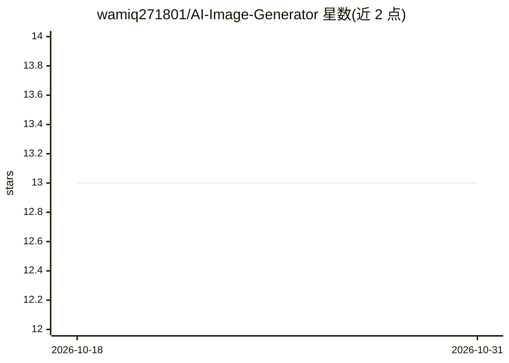

# wamiq271801/AI-Image-Generator

⭐ 13 · JavaScript · Apache-2.0 · 推送 2026-03-10 · [GitHub](https://github.com/wamiq271801/AI-Image-Generator) · [官网](https://main.ai-image-generator-5li.pages.dev) · 个人维护

**基于 Pollinations API 的文生图 Web 应用，Cloudflare Workers 部署**

面向最终用户的文生图 Web 应用：前端 React + Vite + TailwindCSS，后端 Cloudflare Worker 作为网关调用 Pollinations（Flux 模型），浏览器直接从 Pollinations 加载图片，Worker 不代理流量。提供 Quick Try 预设主题、随机种子生成唯一图片、通过 Cloudflare KV 实现每周 1000 张全局限额与每 IP 60 秒一次限流、密钥仅存于 Worker secrets。部署需 Node.js ≥18、Wrangler CLI 与 Cloudflare 账号，支持本地开发运行。

## 筛选速览

| 维度 | 判定 | 备注 |
|---|---|---|
| AI 角色 | `ai-native` | 本体是模型或模型工具 |
| 许可风险 | `permissive` | Apache-2.0 |
| 部署形态 | `library` | 以包/库形式分发 |
| 模型依赖 | — | README 未给出锁定关系 |
| 硬件要求 | — | 无带数字的原话,不猜 |
| 安装摩擦 | `low` | 无编译、无系统依赖或容器化 |
| 成熟度 | — | 结构信号不足 |

## 能力要点

- 文本生成图片（Pollinations Flux 模型，随机种子）
- Worker 网关保护密钥，浏览器直连加载图片
- KV 实现每周 1000 张全局限额与每 IP 限流
- 无需注册、无用户数据跟踪

## 适用场景

- 快速把文字提示词生成图片
- 在 Cloudflare 上部署带限流与限额的文生图站点
- 无登录、注重隐私地使用 AI 生图服务

## 场景标签

`图像生成` · 领域:内容生成

## 证据(README 行号)

> L9: - **AI Image Generation**: Turn text prompts into stunning visuals using the Flux model.
> L3: A production-ready AI image generation web app powered by Pollinations AI, and deployed on Cloudflare Pages + Worker

## 星数曲线

2026-10-18 13 → 2026-10-31 13（+0）

---
*卡片 v1 · prompt 1.4 · 生成 2026-10-31 · 置信度 high · 依据 README sha `ef91f075b791` · [字段定义](../../DATASET.md)*
