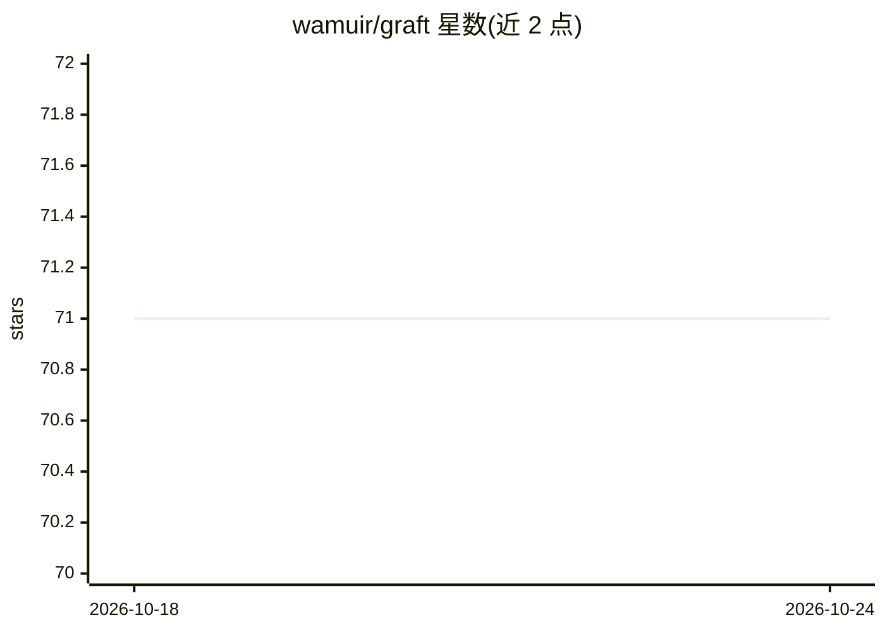

# wamuir/graft

⭐ 71 · Go · Apache-2.0 · 推送 2025-11-05 · [GitHub](https://github.com/wamuir/graft) · [官网](https://pkg.go.dev/github.com/wamuir/graft) · 个人维护

**TensorFlow C API 的 Go 语言绑定库**

提供 TensorFlow C API 的 Go 语言绑定，包含 nightly 与 release 构建、Go 编译的 TensorFlow protocol buffers 以及为 TensorFlow 操作生成的 Go 封装。用法与 TensorFlow 主仓库中的 Go 绑定一致，通过 `github.com/wamuir/graft/tensorflow` 导入。安装前需自行下载或编译并安装 libtensorflow 依赖，随后用 go get 完成安装。面向希望在 Go 项目中使用 TensorFlow 的开发者。

## 筛选速览

| 维度 | 判定 | 备注 |
|---|---|---|
| AI 角色 | `ai-ecosystem` | LLM/agent 周边工具 |
| 许可风险 | `permissive` | Apache-2.0 |
| 部署形态 | `None` |  |
| 模型依赖 | — | README 未给出锁定关系 |
| 硬件要求 | — | 无带数字的原话,不猜 |
| 安装摩擦 | `low` | 无编译、无系统依赖或容器化 |
| 成熟度 | — | 结构信号不足 |

## 能力要点

- 提供 TensorFlow C API 的 nightly 与 release 构建的 Go 绑定
- 包含 Go 编译的 TensorFlow protocol buffers
- 包含为 TensorFlow 操作生成的 Go 封装
- 用法与 TensorFlow 主仓库的 Go 绑定一致

## 适用场景

- 在 Go 项目中调用 TensorFlow 构建和运行模型
- 替换 TensorFlow 主仓库 Go 绑定以获取 nightly 构建
- 用 Go 处理 TensorFlow 协议缓冲与操作封装

## 场景标签

`推理引擎` · 领域:训练与推理

## 证据(README 行号)

> L8: **Go language bindings to the TensorFlow C API**
> L14: Use Graft exactly as you would use the Go bindings found in the main TensorFlow

## 星数曲线

2026-10-18 71 → 2026-10-24 71（+0）

---
*卡片 v1 · prompt 1.4 · 生成 2026-10-24 · 置信度 high · 依据 README sha `cb382a81969c` · [字段定义](../../DATASET.md)*
