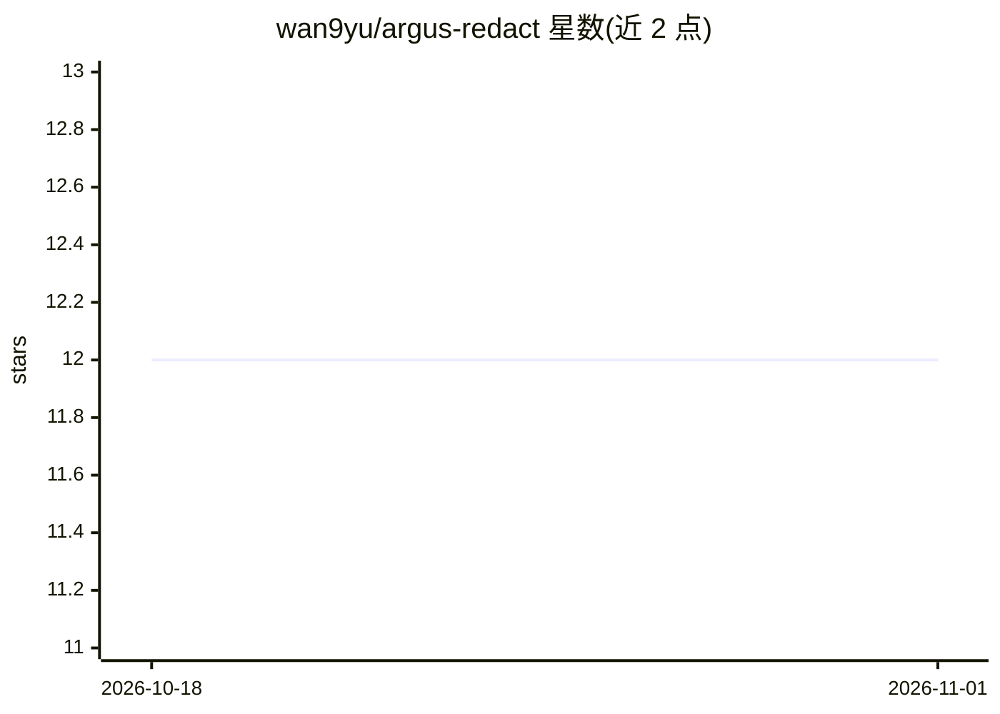

# wan9yu/argus-redact

⭐ 12 · Python · Apache-2.0 · 推送 2026-10-25 · [GitHub](https://github.com/wan9yu/argus-redact) · [官网](https://gateway.agilist.cn) · 个人维护 · 中文 README

**本地 PII 假名化库：LLM 前加密个人身份信息、保留语义**

面向 LLM 管线的隐私处理库：在文本发给云端模型前，用假名替换、掩码、类型编码等方式脱敏 78 类 PII（电话、身份证、医疗信息等），并通过 per-message 密钥支持可逆还原。检测分三层：Rust 正则（<1ms）→ NER → 本地 LLM，逐层传递 hints 协同。中文支持最深（HanLP+原生校验），另覆盖 7 种语言。核心引擎为 Rust/PyO3，提供预编译 wheel。README 明确列出局限：不防对抗性输入、不做合规认证、还原非授权检查。

## 筛选速览

| 维度 | 判定 | 备注 |
|---|---|---|
| AI 角色 | `ai-ecosystem` | LLM/agent 周边工具 |
| 许可风险 | `permissive` | Apache-2.0 |
| 部署形态 | `library` | 以包/库形式分发 |
| 模型依赖 | — | README 未给出锁定关系 |
| 硬件要求 | — | 无带数字的原话,不猜 |
| 安装摩擦 | `low` | 无编译、无系统依赖或容器化 |
| 成熟度 | — | 结构信号不足 |

## 能力要点

- 78 类 PII 三层检测（Rust 正则→NER→本地 LLM），层间 hints 协同
- per-message 密钥的可逆假名化，restore() 一行还原
- 8 种语言覆盖，中文含 15 位旧身份证、汉字数字电话等本地化规则
- Rust 核心 PyO3 封装，fast 模式 <1ms，全平台预编译 wheel

## 适用场景

- 把含身份证、手机号的中文文本发给 LLM 前本地脱敏
- LLM 回复中把假名还原回原文（guard=True 防护）
- 评估文本隐私风险等级（Safe/Caution/Danger/Exposed）

## 场景标签

`网络安全` · 领域:学习与行业

## 证据(README 行号)

> L9: The privacy layer between you and AI. Your identity stays on your device — AI gets the meaning, not you.
> L28: |🛡️|**Protected** — your PII never leaves your device|3-layer local detection: regex → NER → local LLM|
> L127: **When to use argus-redact**: reversible pseudonymization for LLM pipelines where you need `redact() → LLM → guard

## 星数曲线

2026-10-18 12 → 2026-11-01 12（+0）

---
*卡片 v1 · prompt 1.4 · 生成 2026-10-31 · 置信度 high · 依据 README sha `0150d0773c37` · [字段定义](../../DATASET.md)*
