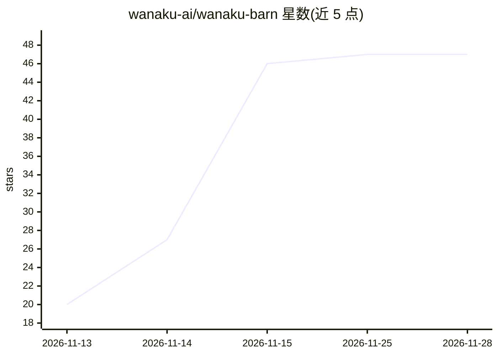

# wanaku-ai/wanaku-barn

⭐ 47 · Java · Apache-2.0 · 推送 2026-11-27 · [GitHub](https://github.com/wanaku-ai/wanaku-barn) · [官网](https://wanaku.ai) · 组织维护

**Wanaku 治理执行代理的企业工具集：CLI、K8s Operator、管理后端**

Wanaku Barn 是面向 Wanaku（AI agent 的治理动作代理）的企业工具集合，包含 Wanaku CLI、用于 Kubernetes/OpenShift 的 Wanaku Operator、管理 Keycloak 凭据的工具以及 Barn 后端；后端存储服务目录并向 Wanaku Admin UI 添加扩展页面，涵盖 Data Stores、模板、Kamelets、语义路由等管理功能。安装方式为在 Wanaku 中以插件形式安装，随后从 releases 下载后端交付物并用 java -jar 启动，也支持从源码构建。

## 筛选速览

| 维度 | 判定 | 备注 |
|---|---|---|
| AI 角色 | `ai-ecosystem` | LLM/agent 周边工具 |
| 许可风险 | `permissive` | Apache-2.0 |
| 部署形态 | `desktop` | 安装包/桌面程序 |
| 模型依赖 | — | README 未给出锁定关系 |
| 硬件要求 | — | 无带数字的原话,不猜 |
| 安装摩擦 | `low` | 无编译、无系统依赖或容器化 |
| 成熟度 | — | 结构信号不足 |

## 能力要点

- 提供 Wanaku CLI 用于命令行管理 Wanaku
- 提供 Kubernetes/OpenShift 的 Wanaku Operator
- Barn 后端存储服务目录并为 Admin UI 添加扩展页面
- 包含管理 Keycloak 凭据的工具

## 适用场景

- 企业环境中部署和运维 Wanaku 治理代理
- 通过命令行管理 Wanaku 与服务目录、数据存储
- 在 Kubernetes/OpenShift 上部署 Wanaku 组件

## 场景标签

 · 领域:企业 AI 集成/agent 治理代理工具

## 证据(README 行号)

> L7: Wanaku Barn is a collection of utilities for Wanaku, the governed action proxy
> L8: for AI agents. It provides the Wanaku CLI, the Wanaku Operator for Kubernetes and OpenShift, tools that administer

## 星数曲线

2026-11-13 20 → 2026-11-28 47（+27）

---
*卡片 v1 · prompt 1.4 · 生成 2026-11-18 · 置信度 high · 依据 README sha `a8fd579ba4a6` · [字段定义](../../DATASET.md)*
