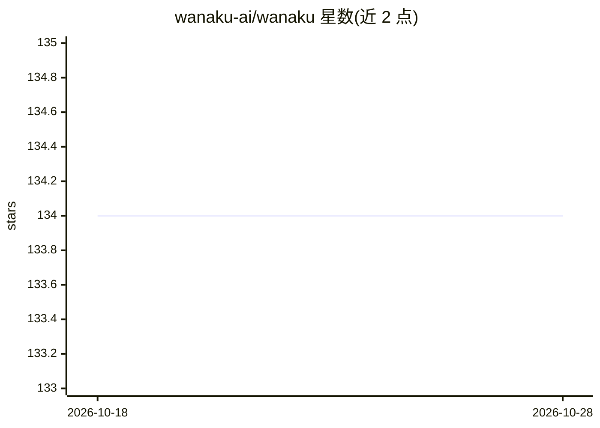

# wanaku-ai/wanaku

⭐ 134 · Rust · Apache-2.0 · 推送 2026-10-27 · [GitHub](https://github.com/wanaku-ai/wanaku) · [官网](https://wanaku.ai) · 组织维护

**面向 AI agent 的受管动作代理：拦截并治理工具调用**

部署在 agent 与后端系统之间的治理代理，拦截 MCP 工具调用、agent 间消息与推理流量。Agent 通过其调用工具而不直接访问后端；代理层以 LLM 评估器与 WASM 动作脚本执行策略分类、过滤与拦截，并经 oauth2-proxy/Keycloak 处理身份认证，支持命名空间隔离与插件扩展。集成开发者可将 Apache Camel 路由发布为工具。提供 Web 管理界面与多架构容器镜像，0.2.0 前名为 Wanaku MCP Router。

## 筛选速览

| 维度 | 判定 | 备注 |
|---|---|---|
| AI 角色 | `ai-ecosystem` | LLM/agent 周边工具 |
| 许可风险 | `permissive` | Apache-2.0 |
| 部署形态 | `None` |  |
| 模型依赖 | — | README 未给出锁定关系 |
| 硬件要求 | — | 无带数字的原话,不猜 |
| 安装摩擦 | `low` | 无编译、无系统依赖或容器化 |
| 成熟度 | `idea` | |

## 能力要点

- 拦截 MCP 工具调用、agent 间消息与推理流量
- LLM 评估器 + WASM 动作脚本执行策略过滤与拦截
- oauth2-proxy/Keycloak 身份认证与命名空间隔离
- Apache Camel 路由可发布为 agent 可调用的工具

## 适用场景

- 企业内部对 agent 工具调用做策略与审计管控
- 将 Camel 集成路由以工具形式暴露给 agent 且隔离后端
- 按团队/租户/环境隔离工具与资源

## 场景标签

`Agent 框架` · 领域:Agent 开发

## 证据(README 行号)

> L7: Wanaku is a governed action proxy for AI agents. It sits between agents and the systems they act on, intercepting
> L15: to publish them as tools. Agents call those tools with parameters, but Wanaku runs the work. Agents never access ba

## 星数曲线

2026-10-18 134 → 2026-10-28 134（+0）

---
*卡片 v1 · prompt 1.4 · 生成 2026-10-22 · 置信度 high · 依据 README sha `f4ce15d20966` · [字段定义](../../DATASET.md)*
