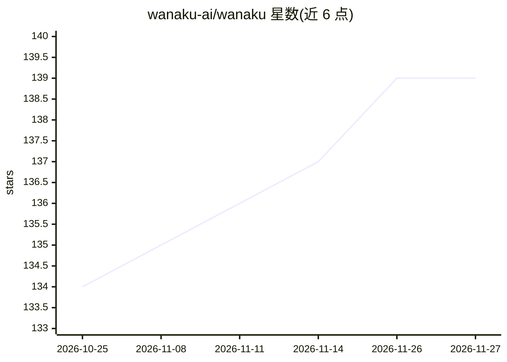

# wanaku-ai/wanaku

⭐ 139 · Rust · Apache-2.0 · 推送 2026-11-26 · [GitHub](https://github.com/wanaku-ai/wanaku) · [官网](https://wanaku.ai) · 组织维护

**AI agent 的受管治动作代理：拦截并管控 MCP 工具调用**

Wanaku 位于 agent 与其操作的系统之间，拦截 MCP 工具调用、agent 间消息与推理流量；agent 通过代理调用工具，不直接访问后端，由代理层执行策略、身份、数据控制与审计要求。支持以 Apache Camel 路由发布为工具，集成 Quarkus，提供基于 oauth2-proxy 与 Keycloak 的认证授权、工具自动发现、命名空间隔离、管理面板。基于 Rust，提供安装脚本、容器镜像、systemd 与 Kubernetes/OpenShift 部署方式；v0.2.0 之前的 Java 版已废弃。

## 筛选速览

| 维度 | 判定 | 备注 |
|---|---|---|
| AI 角色 | `ai-ecosystem` | LLM/agent 周边工具 |
| 许可风险 | `permissive` | Apache-2.0 |
| 部署形态 | `None` |  |
| 模型依赖 | — | README 未给出锁定关系 |
| 硬件要求 | — | 无带数字的原话,不猜 |
| 安装摩擦 | `low` | 无编译、无系统依赖或容器化 |
| 成熟度 | `idea` | |

## 能力要点

- 拦截 MCP 工具调用、A2A 消息与推理流量的代理层
- LLM 评估器 + WASM 动作脚本在代理层分类、过滤和阻断工具调用
- 通过 oauth2-proxy 与 Keycloak 在动作到达后端前做认证授权
- 多架构容器镜像（x86_64、aarch64）自动发布

## 适用场景

- 让 agent 通过受管治的代理访问企业后端系统
- 按团队/租户/环境隔离管理工具与资源
- 对 agent 动作做策略、凭证与审计管控

## 场景标签

`模型网关` · 领域:Agent 开发

## 证据(README 行号)

> L9: Wanaku is a governed action proxy for AI agents. It sits between agents and the systems they act on, intercepting
> L24: - **Policy Enforcement** — LLM-powered evaluators + WASM action scripts classify, filter, and block tool calls in t

## 星数曲线

2026-10-25 134 → 2026-11-27 139（+5）

---
*卡片 v1 · prompt 1.4 · 生成 2026-11-27 · 置信度 high · 依据 README sha `830ea1b2f06a` · [字段定义](../../DATASET.md)*
