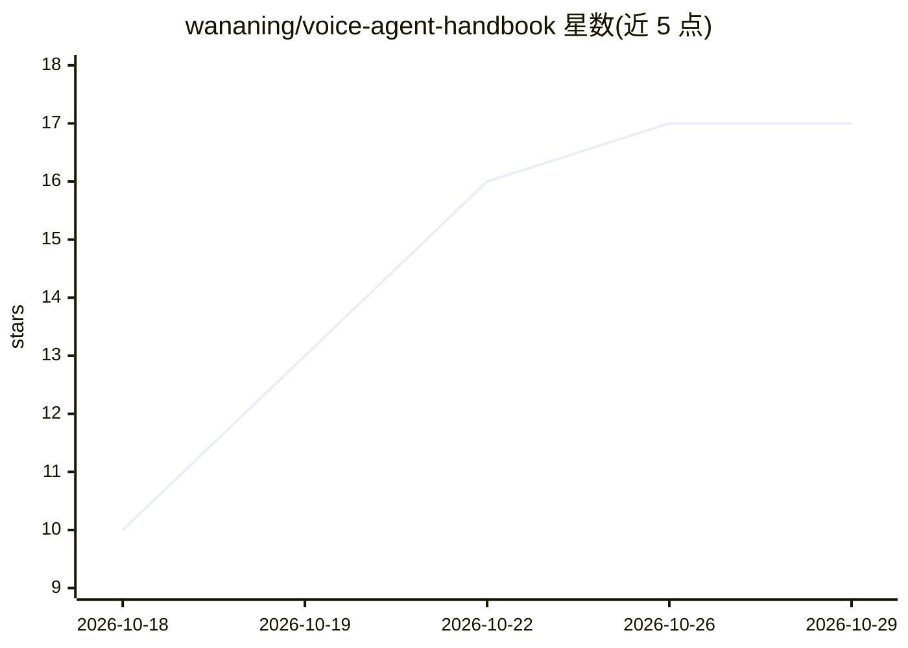

# wananing/voice-agent-handbook

⭐ 17 · Python · CC-BY-4.0 · 推送 2026-10-23 · [GitHub](https://github.com/wananing/voice-agent-handbook) · 个人维护 · 中文 README

**实时语音 agent 架构手册：四种链路形态与七个机制的选型参考**

面向搭建语音 agent 的工程师的架构手册。内容分两层：链路形态（级联、半级联、端到端 S2S、全双工）的取舍与判停、打断、首音、工具回合、会话恢复等七个机制的设计空间；28 个开源项目在这些机制上的具体实现，分析到文件和函数并标注 commit。附框架与模型对比矩阵、决策树与六个场景配方。手册本身不含可运行代码，配套 voice-agent-kit 运行时（另一项目）与一个 Claude Code skill（提供设计顾问、代码评审、搭建助手三种流程及两个脚本）。全部页面目前为草稿状态，含 255 处待确认标注。

## 筛选速览

| 维度 | 判定 | 备注 |
|---|---|---|
| AI 角色 | `ai-knowledge` | 知识聚合/清单类 |
| 许可风险 | `viral` | CC-BY-4.0 |
| 部署形态 | `None` |  |
| 模型依赖 | — | README 未给出锁定关系 |
| 硬件要求 | — | 无带数字的原话,不猜 |
| 安装摩擦 | `low` | 无编译、无系统依赖或容器化 |
| 成熟度 | `idea` | |

## 能力要点

- 覆盖 28 个开源项目，代码路径写到文件和函数并标注 commit
- 四个链路形态 + 七个机制的分类与设计空间
- 配套 Claude Code skill：设计顾问 / 代码评审 / 搭建助手三种流程及首音预算计算器等脚本
- 数字分实测 / 仓库自述 / 推断三类口径，区分标注

## 适用场景

- 搭建语音 agent 前按决策树和场景配方做选型
- 查某个框架（如 pipecat、livekit-agents）在判停、打断等机制上的具体实现与代码位置
- 优化级联链路的首音延迟、处理 S2S 工具回合收口等具体问题
- 在 Claude Code 中用 skill 获得设计问诊、代码评审与搭建辅助

## 场景标签

 · 领域:语音 AI / 实时对话系统

## 证据(README 行号)

> L3: 实时语音 agent 的架构手册。内容分两部分：一是链路形态（级联、半级联、端到端 S2S、全双工）的取舍，以及判停、打断、首音、工具回合、会话恢复等关键机制的设计空间；二是 28 个开源项目在这些机制上的具体实现，分析到文件和函数
> L5: 面向需要搭建或改造语音 agent 的工程师。各层之间以交叉链接组织，可以按问题、按项目或按选型需求选择入口。
> L57: 04 是 28 个项目，分八组。编排框架六个，开源全双工两个，端到端模型三个，ASR 四个，TTS 六个，判停和 VAD 两个，音频前处理和传输三个，端侧两个。每页顶部标注分析所基于的 commit，代码路径写到文件和函数。

## 星数曲线

2026-10-18 10 → 2026-10-29 17（+7）

---
*卡片 v1 · prompt 1.4 · 生成 2026-10-29 · 置信度 high · 依据 README sha `0aa55a06d37c` · [字段定义](../../DATASET.md)*
