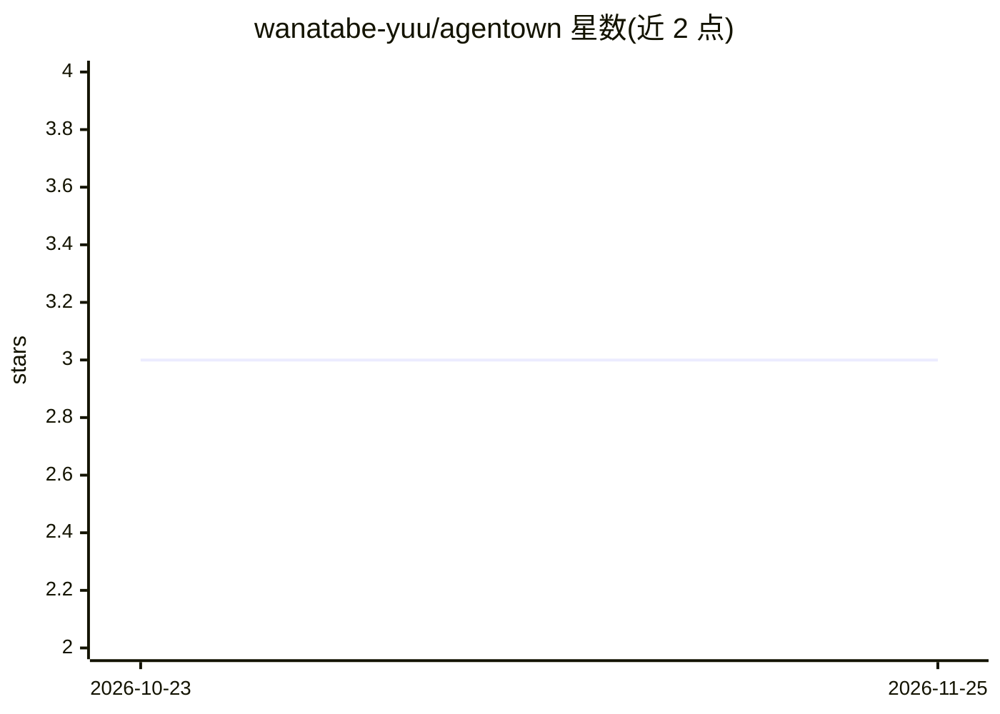

# wanatabe-yuu/agentown

⭐ 3 · TypeScript · MIT · 推送 2026-11-18 · [GitHub](https://github.com/wanatabe-yuu/agentown) · [官网](https://agentown.site) · 个人维护

**自托管的 3D 办公室多智能体组织平台：让 AI 员工有岗位与权限**

在用户自己的服务器上（单机或 k3s 集群）运行一个 AI 智能体组织：每个智能体有名字、岗位、汇报关系、持久化工作区与由服务端强制执行的权限（默认拒绝、按授权范围判定）。智能体在 three.js 渲染的 3D 办公室中工作，可使用带 Chromium/终端/ffmpeg 的真实计算单元；浏览器端查看、审批与审计。世界（组织+办公室）可从市场获取或自建。预装于 Ubuntu 24.04 x86_64，状态为 pre-1.0。

## 筛选速览

| 维度 | 判定 | 备注 |
|---|---|---|
| AI 角色 | `ai-ecosystem` | LLM/agent 周边工具 |
| 许可风险 | `permissive` | MIT |
| 部署形态 | `desktop` | 安装包/桌面程序 |
| 模型依赖 | locked-api |  |
| 硬件要求 | — | 无带数字的原话,不猜 |
| 安装摩擦 | `medium` | 含编译或系统依赖之一 |
| 成熟度 | `idea` | |

## 能力要点

- 服务端强制权限：默认拒绝，授权范围按实时汇报树评估
- 每团队一个 Pod，Kubernetes namespace 隔离与审计日志
- 自带模型接入：密钥留在服务端，智能体经 broker 调用模型
- 世界文件携带组织结构、权限与 3D 办公室，可发布到市场

## 适用场景

- 在自己的服务器上搭建一个带权限层级的智能体组织
- 观察并审批智能体的动作请求与权限申请
- 从市场模板（工厂/视频工作室/医院/实验室）快速开一个世界

## 场景标签

`多智能体` · 领域:Agent 开发

## 证据(README 行号)

> L15: Agentown runs an organization of AI agents on your own servers. Each agent is a lasting employee: a name, a job, a 
> L22: - **Bring your own models.** Anthropic, OpenAI, Gemini, DeepSeek, Grok, Mistral, Groq, OpenRouter, Together or any 
> L70: - **One pod per team.** Each agent runs as a process in its team's runtime, with its own token and workspace. One o

## 星数曲线

2026-10-23 3 → 2026-11-25 3（+0）

---
*卡片 v1 · prompt 1.4 · 生成 2026-11-21 · 置信度 high · 依据 README sha `ef531e341e2e` · [字段定义](../../DATASET.md)*
