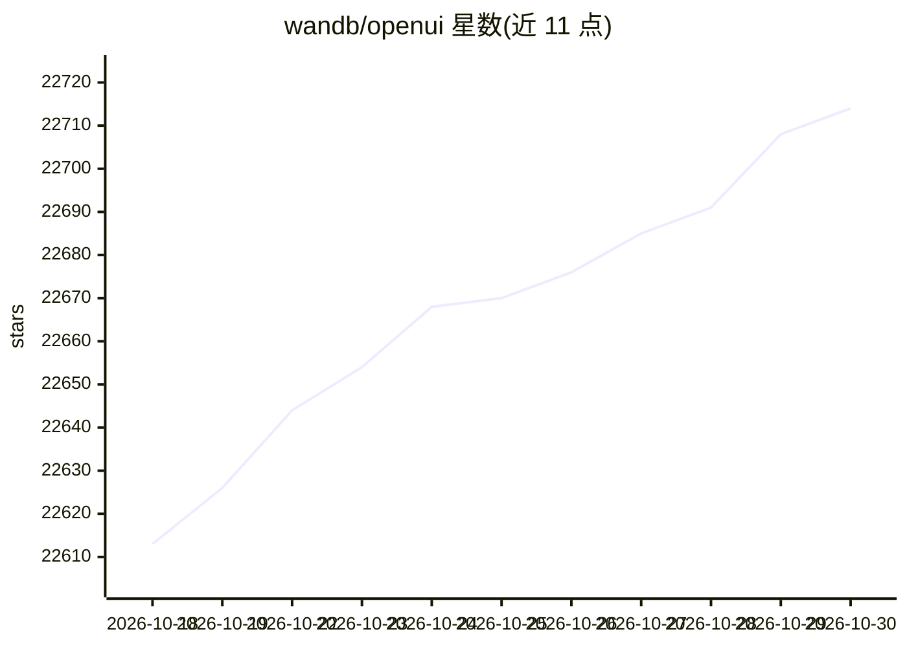

# wandb/openui

⭐ 22,714 · TypeScript · Apache-2.0 · 推送 2026-10-22 · [GitHub](https://github.com/wandb/openui) · [官网](https://openui.fly.dev) · 组织维护

**用自然语言描述并实时渲染生成 UI 的开源工具**

OpenUI 让用户以想象描述界面，实时看到渲染结果，并支持将 HTML 转换为 React、Svelte、Web Components 等框架代码。模型接入通过 LiteLLM 统一代理，支持 OpenAI、Groq、Gemini、Anthropic、Cohere、Mistral 及 OpenAI 兼容端点，也可连接本地 Ollama 实例。安装途径包括 Docker（ghcr.io 镜像）、源码运行（uv/pip）、Docker Compose、Codespace 与 Gitpod。该项目由 W&B 维护，也用于其内部 LLM 应用工具链的原型测试。

## 筛选速览

| 维度 | 判定 | 备注 |
|---|---|---|
| AI 角色 | `ai-enhanced` | 去掉 AI 部分产品仍成立 |
| 许可风险 | `permissive` | Apache-2.0 |
| 部署形态 | `self-host` | docker 或自建部署 |
| 模型依赖 | local-ok | 支持本地模型 |
| 硬件要求 | — | 无带数字的原话,不猜 |
| 安装摩擦 | `low` | 无编译、无系统依赖或容器化 |
| 成熟度 | — | 结构信号不足 |

## 动量与使用信号

- 维护:`active` — 距上次 push 2.1 天,年发版 0,17 位贡献者
- 涨星:近 1 天 **+6**(自 20261016 起算)
- 平台:— · 协议:OPENAI-API / OLLAMA

## 能力要点

- 描述 UI 并实时渲染，可转换为 React/Svelte/Web Components 等框架代码
- 通过 LiteLLM 接入多种 LLM 服务，支持 OpenAI 兼容端点
- 支持本地 Ollama 模型（如 llava），可配置 OLLAMA_HOST
- 提供 Docker、源码、Codespace、Gitpod 多种运行方式

## 适用场景

- 快速将界面描述变成可运行的 UI 原型
- 把生成的 HTML 转换为 React 或 Svelte 组件
- 用本地 Ollama 模型离线生成 UI

## 场景标签

`代码生成` · 领域:编码与开发

## 证据(README 行号)

> L5: Building UI components can be a slog. OpenUI aims to make the process fun, fast, and flexible. It's also a tool we'r
> L11: OpenUI let's you describe UI using your imagination, then see it rendered live. You can ask for changes and convert
> L19: OpenUI supports OpenAI, Groq, and any model LiteLLM supports such as Gemini or Anthropic (Claude). The following en

## 星数曲线

2026-10-18 22,613 → 2026-10-30 22,714（+101）

---
*卡片 v1 · prompt 1.4 · 生成 2026-10-18 · 置信度 high · 依据 README sha `0470ec085f29` · [字段定义](../../DATASET.md)*
