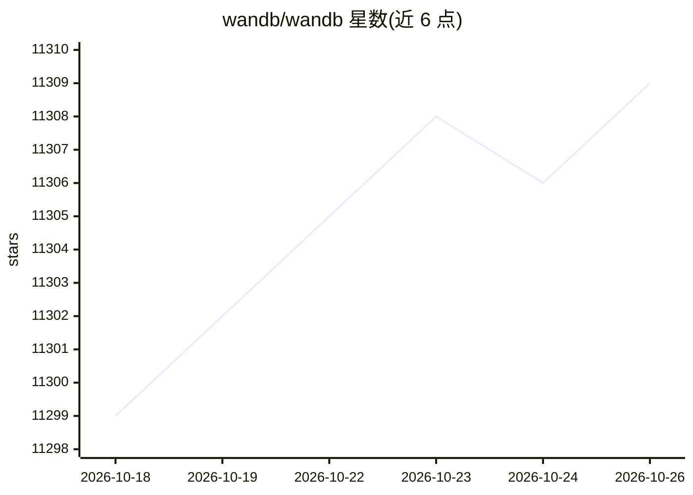

# wandb/wandb

⭐ 11,309 · Python · MIT · 推送 2026-10-25 · [GitHub](https://github.com/wandb/wandb) · [官网](https://wandb.ai) · 组织维护

**面向开发者的 ML 实验跟踪与模型管理平台**

Weights & Biases 提供 Python 库与托管平台，用于记录、可视化和管理机器学习实验：通过 wandb.init() 与日志 API 记录超参数、指标等信息，在网页端查看训练曲线；支持与主流 ML 框架集成，并含 Weave 工具套件用于 LLM 应用的跟踪、调试、评估与监控。部署方式包括云端托管（多租户/专属）与在 AWS/GCP/Azure 或本地基础设施上自托管 W&B Server；使用需注册账号与 API key。库以 MIT 许可发布。

## 筛选速览

| 维度 | 判定 | 备注 |
|---|---|---|
| AI 角色 | `ai-ecosystem` | LLM/agent 周边工具 |
| 许可风险 | `permissive` | MIT |
| 部署形态 | `library` | 以包/库形式分发 |
| 模型依赖 | — | README 未给出锁定关系 |
| 硬件要求 | — | 无带数字的原话,不猜 |
| 安装摩擦 | `low` | 无编译、无系统依赖或容器化 |
| 成熟度 | — | 结构信号不足 |

## 能力要点

- wandb.init() 记录超参数、指标，网页端可视化训练过程
- Weave 工具套件用于 LLM 应用的跟踪、调试、评估与监控
- 三种部署方式：多租户云、专属云、自托管（AWS/GCP/Azure/本地）
- 与主流 ML 框架集成的实验跟踪与数据版本管理

## 适用场景

- 我在训练模型时跟踪超参数与指标并可视化曲线
- 团队需要集中管理从实验到生产的机器学习流水线
- 开发 LLM 应用时需要跟踪、评估和监控其运行表现

## 场景标签

`MLOps` `LLM 可观测性` · 领域:评测与运维

## 证据(README 行号)

> L3: Use W&B to build better models faster. Track and visualize all the pieces of your machine learning pipeline, from da
> L5: Building an LLM app? Track, debug, evaluate, and monitor LLM apps with Weave, our new suite of tools for GenAI.
> L49: W&B integrates with popular ML frameworks and libraries making it fast and easy to set up experiment tracking and d

## 星数曲线

2026-10-18 11,299 → 2026-10-26 11,309（+10）

---
*卡片 v1 · prompt 1.4 · 生成 2026-10-20 · 置信度 high · 依据 README sha `68139c438b66` · [字段定义](../../DATASET.md)*
