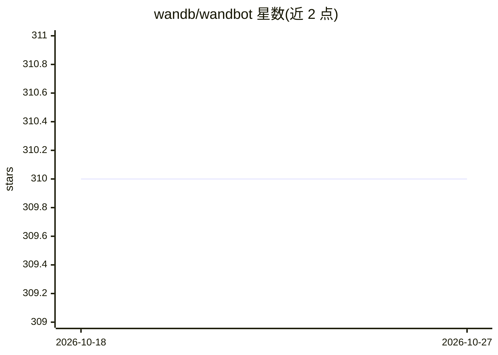

# wandb/wandbot

⭐ 310 · Python · Apache-2.0 · 推送 2026-05-20 · [GitHub](https://github.com/wandb/wandbot) · [官网](https://www.wandb.ai/site) · 组织维护

**Weights & Biases 官方的 RAG 技术支持问答机器人**

面向 W&B Experiment Tracking 与 Weave 文档的技术支持助手：从 W&B 仓库摄取代码与 Markdown 存入托管 ChromaDB 向量库，用 OpenAI v3 embeddings、Gemini flash-2.0 查询增强、GPT-4o（部分版本 Claude Sonnet-3.7）做回答合成、Cohere 重排，构成 RAG 管线；通过 FastAPI 服务与 Discord/Slack bot 交付，支持 Modal 无服务器部署与本地 uvicorn 运行。README 附英文/日文评测表与 Weave 评测流水线、数据摄取模块。需设置 OpenAI/Cohere/W&B 等 API key，回答耗时 30-90 秒。

## 筛选速览

| 维度 | 判定 | 备注 |
|---|---|---|
| AI 角色 | `ai-native` | 本体是模型或模型工具 |
| 许可风险 | `permissive` | Apache-2.0 |
| 部署形态 | `library` | 以包/库形式分发 |
| 模型依赖 | locked-api |  |
| 硬件要求 | — | 无带数字的原话,不猜 |
| 安装摩擦 | `low` | 无编译、无系统依赖或容器化 |
| 成熟度 | — | 结构信号不足 |

## 能力要点

- ChromaDB 向量库 + OpenAI embeddings + Cohere 重排的 RAG 管线
- Discord/Slack 集成与 FastAPI chat/query 端点
- 支持 Modal 无服务器部署与本地 uvicorn 运行
- 内置 Weave 评测流水线（英文/日文数据集）与数据摄取模块

## 适用场景

- 在 Slack/Discord 中向团队回答 W&B 使用问题
- 作为技术文档 RAG 支持机器人的参考实现
- 运行文档摄取与评测流水线持续改进回答正确率

## 场景标签

`RAG` `模型评测` · 领域:评测与运维

## 证据(README 行号)

> L5: WandBot is a support assistant designed for Weights & Biases' Experiment Tracking and Weave.
> L38: - WandBot uses:

## 星数曲线

2026-10-18 310 → 2026-10-27 310（+0）

---
*卡片 v1 · prompt 1.4 · 生成 2026-10-21 · 置信度 high · 依据 README sha `ce1a018453be` · [字段定义](../../DATASET.md)*
