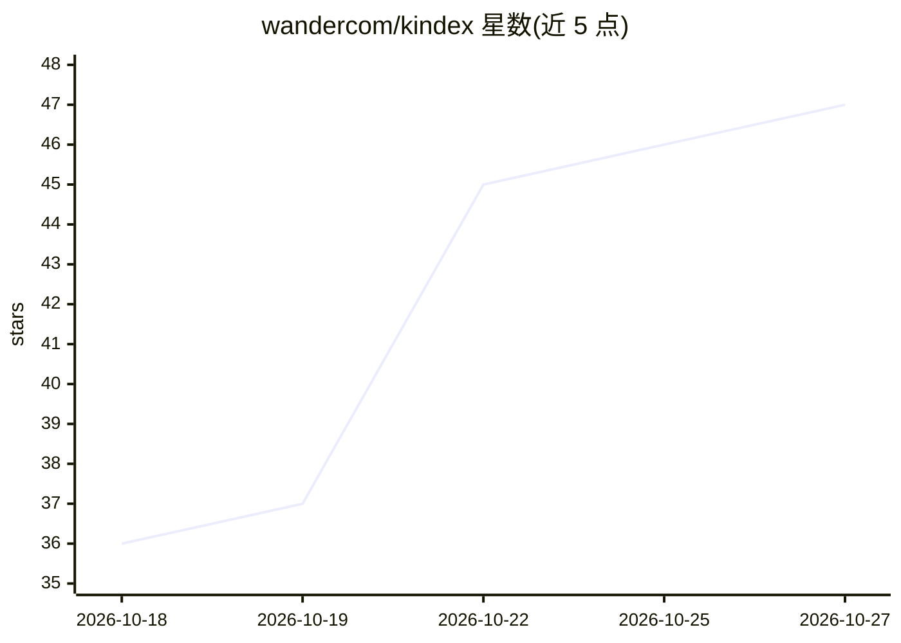

# wandercom/kindex

⭐ 47 · Python · MIT · 推送 2026-10-23 · [GitHub](https://github.com/wandercom/kindex) · [官网](https://wandercom.github.io/kindex/) · 组织维护

**多 AI 编码 agent 共享读写的本地知识图谱（MCP 插件/CLI）**

面向 Claude Code、Codex、Gemini CLI、Cursor 等 MCP-capable agent 的本地知识图谱：带类型节点、来源追溯与衰减机制的加权图，供多个 agent 跨会话共享记忆、交接决策与约束，并按 token 预算控制注入的上下文量。数据存储为本地 SQLite（~/.kindex/ 与仓库内 .kin/），默认不上传。以免费 MCP 插件或独立 CLI（kin/kin-mcp）形式提供，MCP 暴露 50+ 工具；LLM 抽取为可选 extra。注：README 标注为开发预览版（未发布 1.0）。

## 筛选速览

| 维度 | 判定 | 备注 |
|---|---|---|
| AI 角色 | `ai-ecosystem` | LLM/agent 周边工具 |
| 许可风险 | `permissive` | MIT |
| 部署形态 | `library` | 以包/库形式分发 |
| 模型依赖 | — | README 未给出锁定关系 |
| 硬件要求 | — | 无带数字的原话,不猜 |
| 安装摩擦 | `low` | 无编译、无系统依赖或容器化 |
| 成熟度 | `idea` | |

## 能力要点

- 带类型节点、provenance 与衰减机制的加权知识图谱
- 一套图供 7+ 种 MCP agent 读写，跨会话与跨厂商共享
- MCP 暴露 50+ 原生工具（search/learn/link/coord_*/dream 等）
- 数据全存本地 SQLite，LLM/embedding 为可选配置

## 适用场景

- 让不同厂商的编码 agent 共享同一份项目知识与决策
- 跨会话、跨重启保持 agent 对代码库与约束的记忆
- 多个 agent 并行工作时通过图进行任务协调与锁管理

## 场景标签

`知识图谱` `Agent 记忆` · 领域:Agent 开发

## 证据(README 行号)

> L15: Claude Code, Codex, Gemini CLI, Google Antigravity, OpenCode, Cursor, and other MCP-capable agents each remember fo
> L17: > **Memory plugins capture what happened. Kindex captures what it means and how it connects.** Most memory tools ar
> L159: The MCP server exposes 50+ native tools to supported clients: `search`, `add`, `context`, `show`, `ask`, `learn`, 

## 星数曲线

2026-10-18 36 → 2026-10-27 47（+11）

---
*卡片 v1 · prompt 1.4 · 生成 2026-10-25 · 置信度 high · 依据 README sha `d3b45a546d6f` · [字段定义](../../DATASET.md)*
