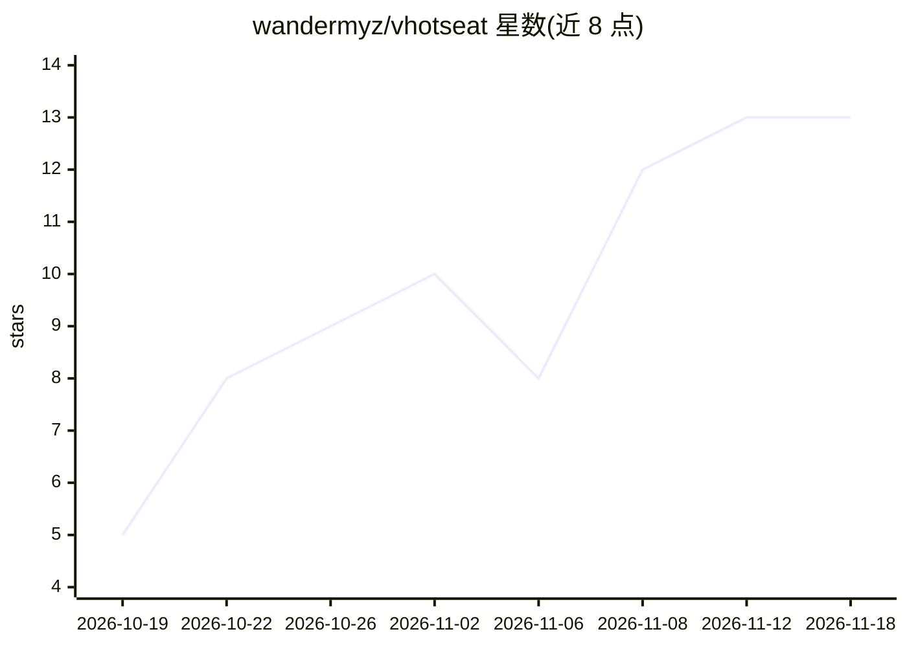

# wandermyz/vhotseat

⭐ 13 · Python · MIT · 推送 2026-11-16 · [GitHub](https://github.com/wandermyz/vhotseat) · 个人维护

**单张 GPU 上让本地 LLM 与 ComfyUI 等负载轮流占卡的工具**

vhotseat 是一个 GPU 仲裁器：多个客户端（agent、脚本、Web UI、curl）在加载前通过 gate 申请 GPU，工具卸载其他负载腾出显存与内存，且不中断正在写入的回答或进行中的渲染。内置 Strata（LLM）与 ComfyUI 两类示例驱动，任何 GPU 负载可经配置项或小型 driver 接入。通过 uv/pipx 安装为 CLI，附带状态检查、GPU 占用查询与仪表盘命令。当前状态为 Linux + NVIDIA，Windows 计划中，MIT 许可。

## 筛选速览

| 维度 | 判定 | 备注 |
|---|---|---|
| AI 角色 | `ai-ecosystem` | LLM/agent 周边工具 |
| 许可风险 | `permissive` | MIT |
| 部署形态 | `None` |  |
| 模型依赖 | — | README 未给出锁定关系 |
| 硬件要求 | — | 无带数字的原话,不猜 |
| 安装摩擦 | `low` | 无编译、无系统依赖或容器化 |
| 成熟度 | — | 结构信号不足 |

## 能力要点

- gate 机制协调任意多种 GPU 负载轮流使用，运行中的任务不被中断
- admission 在加载前检查空闲 VRAM 与 RAM，并可重启闲置 ComfyUI 释放内存
- comfy-render 让 agent 一次调用批量运行工作流
- 提供 doctor/status/web 三类诊断与仪表盘命令

## 适用场景

- 在同一张消费级显卡上让本地 LLM agent 驱动 ComfyUI 渲染而不 OOM
- 夜间无人值守运行多轮渲染-审查工作流
- 把 TTS 服务器、训练任务等其他 GPU 负载纳入同一调度

## 场景标签

`图像生成` `语音合成` · 领域:内容生成

## 证据(README 行号)

> L49: scripts, a web UI, curl. Nobody calls vhotseat; each workload asks for the GPU
> L50: through a **gate** right before it loads, and vhotseat makes room by releasing
> L62: Strata and ComfyUI are just the built-in examples: anything that uses the GPU

## 星数曲线

2026-10-19 5 → 2026-11-18 13（+8）

---
*卡片 v1 · prompt 1.4 · 生成 2026-11-18 · 置信度 high · 依据 README sha `3bb411eb8c60` · [字段定义](../../DATASET.md)*
