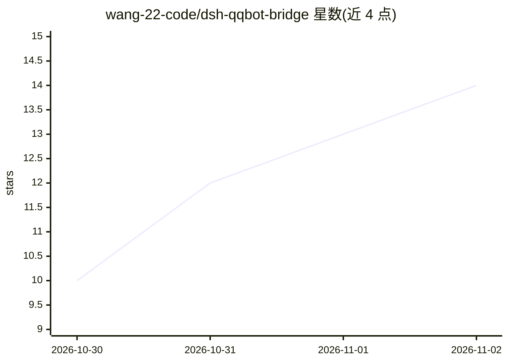

# wang-22-code/dsh-qqbot-bridge

⭐ 14 · TypeScript · MIT · 推送 2026-09-06 · [GitHub](https://github.com/wang-22-code/dsh-qqbot-bridge) · 个人维护 · 中文 README

**将 DeepSeek Harness（DSH）Agent 接入 QQ 的官方 Bot API 桥接插件**

基于腾讯官方 QQ 机器人开放平台与官方 SDK 的 DSH 插件：QQ 私聊或群聊消息直接驱动一个独立的 DSH Agent 会话，支持流式回复、发送失败重试、会话持久化、/model 切换模型。访问控制默认私聊白名单、群聊关闭；支持在 QQ 内通过 /approve、/deny 处理 DSH 一次性权限申请（120 秒超时自动拒绝）。运行需 Node.js ≥ 22 与 DeepSeek API Key，提供 Windows/Linux/macOS 一键启动脚本；版本 0.1.0，自述处于早期阶段。派生自腾讯 MIT 项目 @tencent-connect/dsh-qqbot，社区独立维护。

## 筛选速览

| 维度 | 判定 | 备注 |
|---|---|---|
| AI 角色 | `ai-ecosystem` | LLM/agent 周边工具 |
| 许可风险 | `permissive` | MIT |
| 部署形态 | `desktop` | 安装包/桌面程序 |
| 模型依赖 | locked-api |  |
| 硬件要求 | — | 无带数字的原话,不猜 |
| 安装摩擦 | `medium` | 含编译或系统依赖之一 |
| 成熟度 | `idea` | |

## 能力要点

- 仅用腾讯官方 Bot API 与官方 SDK，首次启动扫码自动绑定
- 私聊默认白名单、群聊默认关闭，QQ 内一次性权限审批（/approve、/deny）
- 流式回复、发送失败自动重试、会话持久化与 /model 模型切换
- 敏感凭据仅存本机 $DSH_HOME/.env，内置隐私扫描与 CI 检查

## 适用场景

- 把 DSH Agent 挂到自己的 QQ 机器人上，在 QQ 里直接对话
- 通过 QQ 远程审批 Agent 访问工作区外路径的权限申请
- 在白名单约束下让指定 QQ 好友使用自己的 DSH 会话

## 场景标签

`聊天机器人` · 领域:对话与助手

## 证据(README 行号)

> L3: 基于腾讯官方 QQ 机器人开放平台，将 QQ 私聊或群聊安全地接入 DeepSeek Harness（DSH）。给机器人发送消息，就等同于向一个独立的 DSH Agent 会话发送消息。
> L12: - QQ 消息直接驱动 DSH Agent，支持流式回复、发送失败自动重试、会话持久化和模型切换。

## 星数曲线

2026-10-30 10 → 2026-11-02 14（+4）

---
*卡片 v1 · prompt 1.4 · 生成 2026-10-31 · 置信度 high · 依据 README sha `12d74eed6cbb` · [字段定义](../../DATASET.md)*
