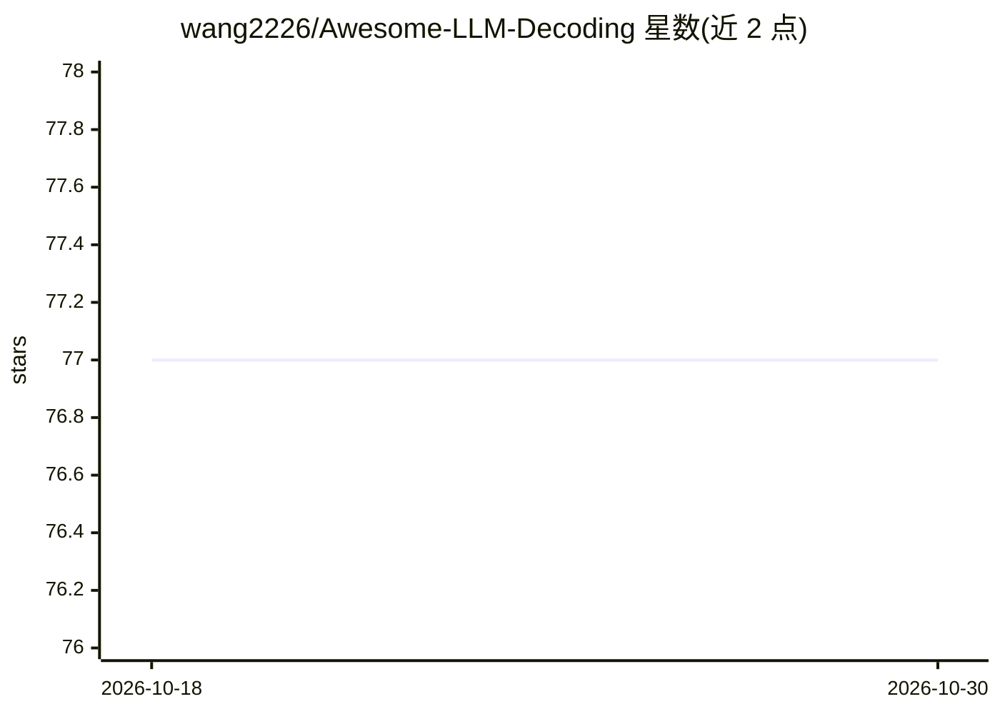

# wang2226/Awesome-LLM-Decoding

⭐ 77 · Apache-2.0 · 推送 2026-09-23 · [GitHub](https://github.com/wang2226/Awesome-LLM-Decoding) · 个人维护

**LLM/LVLM 解码方法研究论文清单（配套已发表论文综述）**

围绕大语言模型与大视觉语言模型解码方法的论文聚合清单，配套综述发表于 ACM SIGKDD Explorations Newsletter（Vol.28 Issue 1）。清单将解码算法按三种范式组织：对比解码（Contrastive）、引导解码（Guided）、并行解码（Parallel），另含综述、QuickStart 学习资源（教程与视频）等板块，条目附作者与 pdf/code 链接。面向从事 LLM 推理与生成控制研究的读者，无代码或安装内容。

## 筛选速览

| 维度 | 判定 | 备注 |
|---|---|---|
| AI 角色 | `ai-knowledge` | 知识聚合/清单类 |
| 许可风险 | `permissive` | Apache-2.0 |
| 部署形态 | `None` |  |
| 模型依赖 | — | README 未给出锁定关系 |
| 硬件要求 | — | 无带数字的原话,不猜 |
| 安装摩擦 | `low` | 无编译、无系统依赖或容器化 |
| 成熟度 | — | 结构信号不足 |

## 能力要点

- 按三种解码范式（对比/引导/并行）分类组织论文
- 配套综述发表于 ACM SIGKDD Explorations Newsletter
- QuickStart 板块收录 NeurIPS 教程、Hugging Face 教程与多门课程视频
- 覆盖 LLM 与 LVLM（多模态）两类模型的解码研究

## 适用场景

- 查找对比解码、引导解码、投机解码等方向的论文与代码
- 系统学习 LLM/LVLM 解码方法的研究脉络
- 为综述写作或选型调研收集解码算法文献

## 场景标签

`精选清单` `科研工具` · 领域:学习与行业

## 证据(README 行号)

> L21: - This paper list compiles relevant research on decoding methods for both LLMs and LVLMs.
> L27: In this paper, we survey and categorize research on decoding methods for foundation models along two key dimensions

## 星数曲线

2026-10-18 77 → 2026-10-30 77（+0）

---
*卡片 v1 · prompt 1.4 · 生成 2026-10-24 · 置信度 high · 依据 README sha `4e2b240bc18d` · [字段定义](../../DATASET.md)*
