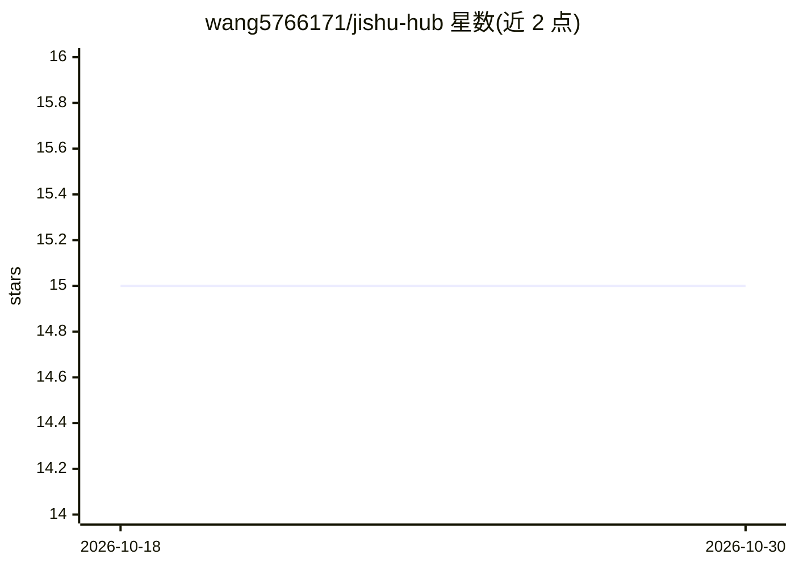

# wang5766171/jishu-hub

⭐ 15 · Rust · MIT · 推送 2026-10-26 · [GitHub](https://github.com/wang5766171/jishu-hub) · 个人维护 · 中文 README

**桌面端多 Agent 协作平台：统一管理 CLI 型 AI 编码代理**

基于 Tauri v2 + Rust 的 Windows 桌面应用，将 Claude Code、OpenAI Codex、Open Code、Jishu Self 等 CLI 型 AI 代理接入统一界面：原生 CLI 直通（无代理层）、应用内多模态聊天、并行会话、项目自动发现与全文会话搜索、可视化配置编辑器（内置 OpenRouter/SiliconFlow 等模板）。v0.6.0 起附带 jishu CLI（15 个子命令）、planner/dispatcher 编排引擎、ACP 协议服务器与后台守护模式。数据仅存本地（~/.jishu-hub/），系统要求 Windows 10+。

## 筛选速览

| 维度 | 判定 | 备注 |
|---|---|---|
| AI 角色 | `ai-ecosystem` | LLM/agent 周边工具 |
| 许可风险 | `permissive` | MIT |
| 部署形态 | `library` | 以包/库形式分发 |
| 模型依赖 | locked-api |  |
| 硬件要求 | — | 无带数字的原话,不猜 |
| 安装摩擦 | `low` | 无编译、无系统依赖或容器化 |
| 成熟度 | — | 结构信号不足 |

## 能力要点

- 插件式 Agent 注册，支持 Claude Code / OpenAI Codex / Open Code / Jishu Self 一键切换
- v0.6.0 编排引擎：planner/dispatcher 架构、jishu CLI 15 个子命令、ACP JSON-RPC 服务器、守护模式
- 可视化配置编辑器，内置 OpenRouter / SiliconFlow 等提供商模板与自动备份
- 数据本地存储（~/.jishu-hub/），不上传

## 适用场景

- 在一个桌面界面里管理和切换多个 CLI 编码代理，替代分散的终端窗口
- 跨项目并行运行多个 agent 会话且互不干扰上下文
- 不用手改 JSON，通过表单编辑器管理各代理的模型与环境变量配置

## 场景标签

`多智能体` `编码 Agent` · 领域:Agent 开发

## 证据(README 行号)

> L18: **Jishu Hub (机枢)** is a multi-agent collaboration platform that unifies these CLI-based AI agents in one desktop in
> L73: - Currently supports **Claude Code**, **OpenAI Codex**, **Open Code**, **Jishu Self**

## 星数曲线

2026-10-18 15 → 2026-10-30 15（+0）

---
*卡片 v1 · prompt 1.4 · 生成 2026-10-30 · 置信度 high · 依据 README sha `e424594e63f0` · [字段定义](../../DATASET.md)*
