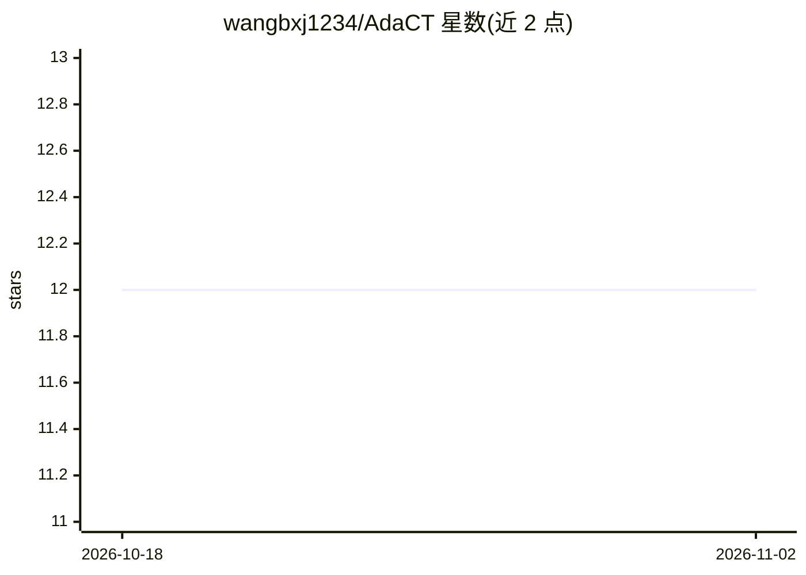

# wangbxj1234/AdaCT

⭐ 12 · Python · MIT · 推送 2026-05-12 · [GitHub](https://github.com/wangbxj1234/AdaCT) · 个人维护

**将 EEG 转为图像/文本以微调预训练 Transformer 的 AdaCE 实现**

AdaCE 的 PyTorch 官方实现：设计即插即用适配器，把脑电（EEG）数据转换为图像与文本形式，用于微调预训练的视觉与语言 Transformer，完成 EEG 预测任务。摘要报告在 UCI HAR 人体活动识别解码任务上，基于 Swin-Transformer 达到 99.6%。模块也可用于其他多通道时间序列数据。README 仅含摘要与框架说明，代码声明尚未发布，未给出安装运行方式。

## 筛选速览

| 维度 | 判定 | 备注 |
|---|---|---|
| AI 角色 | `ai-native` | 本体是模型或模型工具 |
| 许可风险 | `permissive` | MIT |
| 部署形态 | `None` |  |
| 模型依赖 | — | README 未给出锁定关系 |
| 硬件要求 | — | 无带数字的原话,不猜 |
| 安装摩擦 | `low` | 无编译、无系统依赖或容器化 |
| 成熟度 | — | 结构信号不足 |

## 能力要点

- 即插即用适配器将 EEG 转为图像/文本形式
- 微调预训练视觉与语言 Transformer
- 可推广到其他多通道时间序列数据

## 适用场景

- 用预训练 Transformer 做 EEG 解码与预测任务的研究者
- 探索图像/文本预训练模型迁移到生理信号的任务
- 处理多通道时间序列分类的研究实验

## 场景标签

`微调` · 领域:训练与推理

## 证据(README 行号)

> L2: Official PyTorch implementation of AdaCE
> L3: > **Abstract:** Pre-trained large transformer models have achieved remarkable performance in the fields of natural l

## 星数曲线

2026-10-18 12 → 2026-11-02 12（+0）

---
*卡片 v1 · prompt 1.4 · 生成 2026-10-31 · 置信度 mid · 依据 README sha `b59bc615f329` · [字段定义](../../DATASET.md)*
