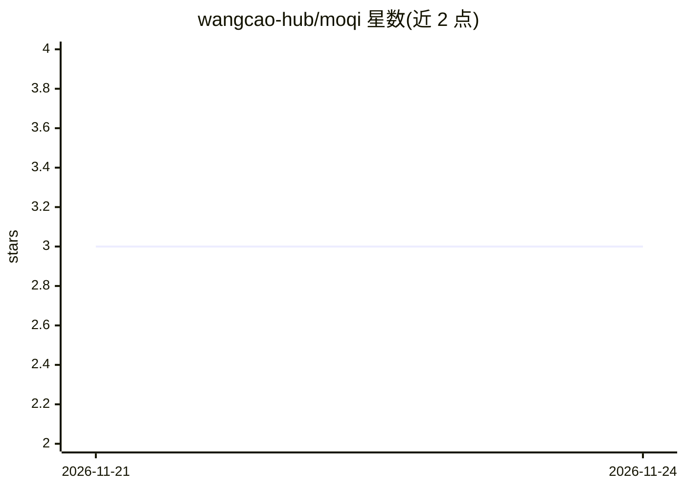

# wangcao-hub/moqi

⭐ 4 · TypeScript · Apache-2.0 · 推送 2026-11-23 · [GitHub](https://github.com/wangcao-hub/moqi) · [官网](https://www.npmjs.com/package/moqi-agent) · 个人维护 · 中文 README

**主动开口的个人 AI 助手：从日常了解你，TypeScript 跨桌面手机**

一款个人代理，运行于 Node 之上，核心为纯 TypeScript。它以 append-only 事件日志保存全部状态，用户模型由日志回放得出；每两小时自主反思生成最多三条想法（代办、提问、新闻），每类主动消息须通过阈值门控，且按动作类别逐级积累信任（inform→suggest→auto-undo→auto）。内置天气、日历插件，支持 MCP 与 A2A 协议与其他代理互通，控制台界面当前为中文。模型为可配置项：无模型时简报与监视仍可用。

## 筛选速览

| 维度 | 判定 | 备注 |
|---|---|---|
| AI 角色 | `ai-native` | 本体是模型或模型工具 |
| 许可风险 | `permissive` | Apache-2.0 |
| 部署形态 | `library` | 以包/库形式分发 |
| 模型依赖 | local-ok | 支持本地模型 |
| 硬件要求 | — | 无带数字的原话,不猜 |
| 安装摩擦 | `low` | 无编译、无系统依赖或容器化 |
| 成熟度 | — | 结构信号不足 |

## 能力要点

- 主动式设计：每两小时自主思考，最多三条想法，静音时段与每日预算限制打扰
- 信任按动作类别逐级授予（inform→suggest→auto-undo→auto），无全局自治模式
- 全部状态存于单一 append-only 日志，备份即复制一个文件
- 通过 MCP 与 A2A 与其他代理互通，可自动发现本机的 Cursor/Claude Code 等代理

## 适用场景

- 让助手在我不问的情况下主动提醒天气、日程与新闻
- 把对我的了解共享给编码代理做个性化
- 用本地模型在桌面端运行一个记忆我的私人助手

## 场景标签

`AI 助手` `Agent 记忆` · 领域:Agent 开发

## 证据(README 行号)

> L5: **A personal agent you don't have to ask.** moqi (默契, "tacit understanding") learns you from everyday life, speaks u
> L9: Most assistants wait to be asked. moqi works the other way round. Every couple of hours, and soon after you talk to 
> L62: Any OpenAI-compatible model works. A local Ollama needs no key: `qwen3:4b` (2.5 GB) runs anywhere, and Muse Glimmer

## 星数曲线

2026-11-21 3 → 2026-11-24 3（+0）

---
*卡片 v1 · prompt 1.4 · 生成 2026-11-21 · 置信度 high · 依据 README sha `4eb469c89cab` · [字段定义](../../DATASET.md)*
