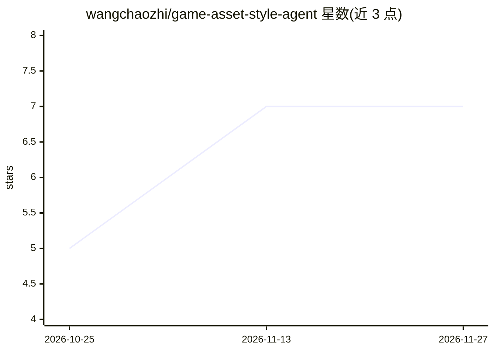

# wangchaozhi/game-asset-style-agent

⭐ 7 · TypeScript · MIT · 推送 2026-11-14 · [GitHub](https://github.com/wangchaozhi/game-asset-style-agent) · 个人维护 · 中文 README

**面向游戏开发者的风格一致素材生成 Web 应用：Claude 审核批量出图**

上传风格参考图后，由 Claude 提炼结构化风格指南（色板、技法、线条、光影等），据此规划素材清单并调用图像模型批量生成，逐张做一致性评分审核，跑偏带具体意见重画。支持 10 类游戏素材、色差检测（Lab 色彩空间）、本地后处理工具（接缝修复、帧对齐、九宫格、去背景）以及 Godot/Unity/Phaser/Cocos 格式的分目录导出。需配置 ANTHROPIC_API_KEY 与图像模型 key，另有免 key 的演示模式。

## 筛选速览

| 维度 | 判定 | 备注 |
|---|---|---|
| AI 角色 | `ai-native` | 本体是模型或模型工具 |
| 许可风险 | `permissive` | MIT |
| 部署形态 | `self-host` | docker 或自建部署 |
| 模型依赖 | locked-api |  |
| 硬件要求 | — | 无带数字的原话,不猜 |
| 安装摩擦 | `low` | 无编译、无系统依赖或容器化 |
| 成熟度 | — | 结构信号不足 |

## 能力要点

- Claude 担任审核环节：生成后对照参考图打 1–10 一致性分并决定重画（每张最多 2 次）
- 图像模型可插拔：gpt-image-1、Gemini Image、本地 Stable Diffusion WebUI、离线 Mock
- 多种不调用图像模型的本地后处理工具（瓦片无缝化、帧对齐、吸附色板等）
- 导出含多尺寸、manifest 及 Godot/Unity/Phaser/Cocos 引擎预设

## 适用场景

- 为独立游戏批量生成风格统一的素材与精灵表
- 生成风格说明书发给外包美术作为规范
- 接已有素材作参考，扩展同角色动画帧与头像

## 场景标签

`图像生成` · 领域:内容生成

## 证据(README 行号)

> L7: 上传几张风格参考图，由 Claude 担任「AI 美术总监」：先从参考图提炼可复用的**风格指南**（色板 hex、技法、线条、光影、视角、比例），再按你的需求规划素材清单、调用图像模型批量生成，**逐张看图审核**，风格跑偏就带着
> L33: - 🔌 图像模型可插拔：OpenAI `gpt-image-1`（多图参考 edits）、Google Gemini Image、本地 Stable Diffusion WebUI（AUTOMATIC1111 / Forge，可选

## 星数曲线

2026-10-25 5 → 2026-11-27 7（+2）

---
*卡片 v1 · prompt 1.4 · 生成 2026-11-20 · 置信度 high · 依据 README sha `169a172a7a1c` · [字段定义](../../DATASET.md)*
