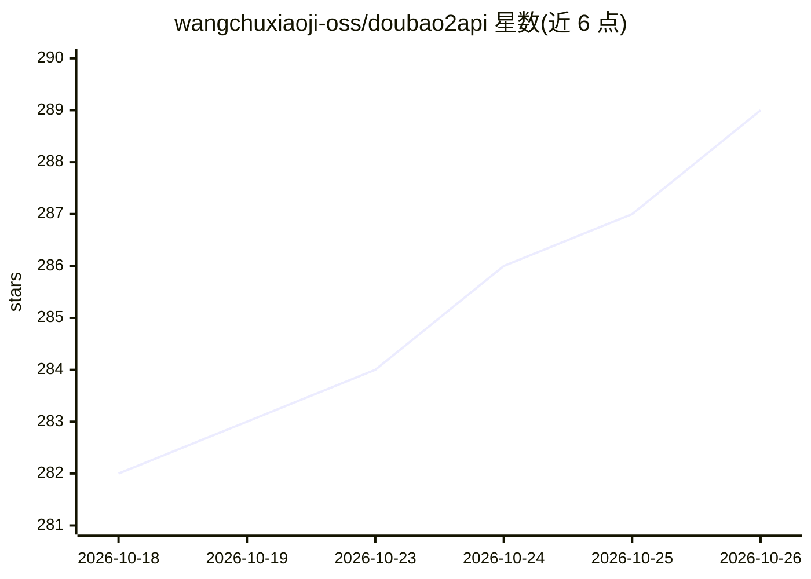

# wangchuxiaoji-oss/doubao2api

⭐ 289 · Python · Apache-2.0 · 推送 2026-05-24 · [GitHub](https://github.com/wangchuxiaoji-oss/doubao2api) · [官网](https://wangchuxiaoji-oss.github.io/doubao2api/) · 个人维护 · 中文 README

**逆向豆包客户端 API，为 Agent 提供免费多模态能力**

通过逆向豆包（Doubao）客户端 API，将对话、识图、文件读取（60+ 种格式）、图片/音乐/视频生成封装为 OpenAI 兼容接口与 Python 客户端，面向为纯文本模型 Agent（如基于 DeepSeek 的 Hermes Agent）补全多模态能力的开发者。认证经 QR 扫码登录获取 Cookie，调用豆包内部 SSE 端点；提供 /v1/files 文件中转（单文件最大 1GB）。限制：不支持 Function Calling/Tool Use，不适合编程智能体；生成图片带水印，视频每日约 10 次免费额度。

## 筛选速览

| 维度 | 判定 | 备注 |
|---|---|---|
| AI 角色 | `ai-ecosystem` | LLM/agent 周边工具 |
| 许可风险 | `permissive` | Apache-2.0 |
| 部署形态 | `self-host` | docker 或自建部署 |
| 模型依赖 | — | README 未给出锁定关系 |
| 硬件要求 | — | 无带数字的原话,不猜 |
| 安装摩擦 | `low` | 无编译、无系统依赖或容器化 |
| 成熟度 | — | 结构信号不足 |

## 能力要点

- 多模态对话/理解与图片、音乐、视频生成，OpenAI 兼容接口
- QR 扫码登录认证，支持 60+ 种文件格式读取
- /v1/files 文件中转站：永久 TOS URI，单文件最大 1GB
- 不支持 Function Calling/Tool Use，README 明示不适合编程智能体

## 适用场景

- 为纯文本模型 Agent 补充识图与文件阅读能力
- 通过统一接口生成图片、音乐（31 个预设模板）与视频
- 跨服务器文件传输：上传获取永久 URI，他处换取下载链接

## 场景标签

`模型网关` `多模态` `图像生成` `视频生成` · 领域:Agent 开发

## 证据(README 行号)

> L11: 逆向豆包（Doubao）客户端 API，为 AI 智能体提供免费的多模态能力。通过 OpenAI 兼容接口，让任何纯文本模型也能识图、读文件、生成图片/音乐/视频。
> L19: 本项目适合为通用 AI 智能体（如 OpenClaw、Hermes 等对话/任务型 Agent）补全多模态能力。
> L32: 通过 QR 扫码登录（全平台）获取 `sessionid` 等认证 Cookie，然后调用豆包内部 SSE 流式端点实现对话、图片/视频/音乐生成。

## 星数曲线

2026-10-18 282 → 2026-10-26 289（+7）

---
*卡片 v1 · prompt 1.4 · 生成 2026-10-22 · 置信度 high · 依据 README sha `704b2454d4f1` · [字段定义](../../DATASET.md)*
