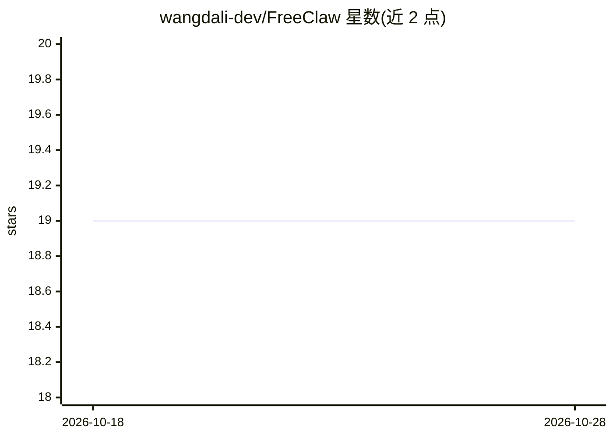

# wangdali-dev/FreeClaw

⭐ 19 · Python · MIT · 推送 2026-03-13 · [GitHub](https://github.com/wangdali-dev/FreeClaw) · 个人维护 · 中文 README

**Windows 一键部署 OpenClaw+Ollama 的便携启动器**

面向 Windows 用户（尤其非技术用户）的本地启动器，一键下载、校验并运行 OpenClaw、Ollama、Node.js、Git 便携版，自动拉取模型、写入配置并启动本地 Gateway 服务。支持启动/停止服务、打开 Web 控制台、选择下载镜像与模型源。提供 Releases 的 exe 与源码两种运行方式（python main.py，GUI 用 Tkinter）。附带 GPU 未启用（推理落在内存而非显存）的排查指引，涉及显卡选择、驱动更新与 Ollama 环境变量。

## 筛选速览

| 维度 | 判定 | 备注 |
|---|---|---|
| AI 角色 | `ai-ecosystem` | LLM/agent 周边工具 |
| 许可风险 | `permissive` | MIT |
| 部署形态 | `desktop` | 安装包/桌面程序 |
| 模型依赖 | local-ok | 支持本地模型 |
| 硬件要求 | — | 无带数字的原话,不猜 |
| 安装摩擦 | `medium` | 含编译或系统依赖之一 |
| 成熟度 | — | 结构信号不足 |

## 能力要点

- 一键安装并启动 OpenClaw、Ollama、Node.js、Git（便携版），依赖自动下载与校验
- 一键拉取模型并自动写入 OpenClaw 配置
- 支持选择下载镜像与模型源，可自定义模型名
- 提供 GPU 未启用/推理 offload 到 CPU 的排查流程

## 适用场景

- 不会配环境也想在本地跑 OpenClaw + Ollama 小模型
- 零 token 花费体验 OpenClaw
- 排查模型推理占用内存而非显存的问题

## 场景标签

 · 领域:AI 应用部署/桌面工具

## 证据(README 行号)

> L1: # OpenClaw 便携版启动器（Ollama）
> L3: 这是一个面向 Windows 的本地启动器，用于一键部署并运行 OpenClaw + Ollama。本项目会自动下载并校验依赖，然后启动本地 Gateway，适合非技术用户快速上手。
> L7: - 一键安装并启动 OpenClaw、Ollama、Node.js、Git（便携版）

## 星数曲线

2026-10-18 19 → 2026-10-28 19（+0）

---
*卡片 v1 · prompt 1.4 · 生成 2026-10-28 · 置信度 high · 依据 README sha `7187c9038d69` · [字段定义](../../DATASET.md)*
