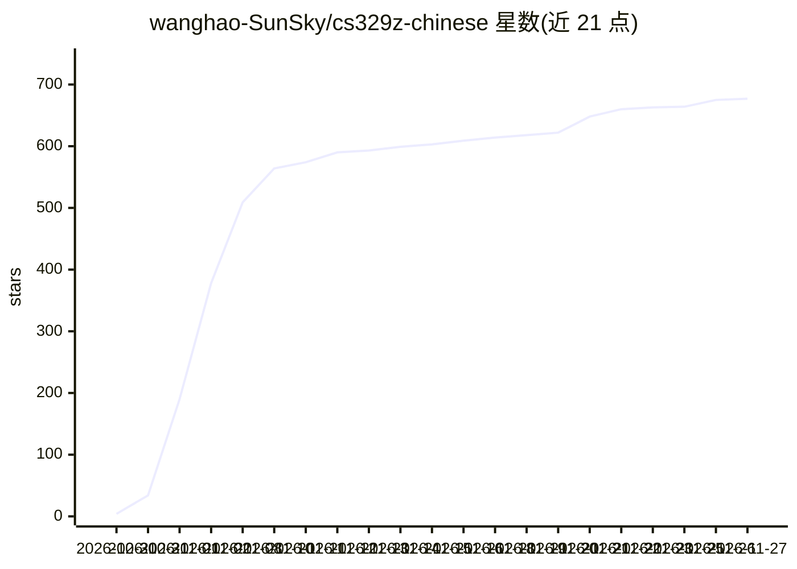

# wanghao-SunSky/cs329z-chinese

⭐ 677 · HTML · 推送 2026-11-06 · [GitHub](https://github.com/wanghao-SunSky/cs329z-chinese) · [官网](https://cs329z-course-review-20261029.wanghao162263.chatgpt.site) · 个人维护 · 中文 README

**面向 Python 开发者的斯坦福 CS329Z Agent 课程中文自学教程**

基于斯坦福 CS329Z 公开材料独立整理的中文学习资料，包含 19 讲教程与 4 项实践，覆盖 LLM、RAG、工具调用、记忆、多 Agent 协作、评测与安全防护，并提供 HW1 配套代码的阅读指南。内容以 Markdown 源文件组织，附带支持搜索、目录、深浅主题的在线网页和单文件离线 HTML。面向会写 Python、了解基本 API 调用的读者。README 声明为非官方中文版，原课程权利归各自作者。

## 筛选速览

| 维度 | 判定 | 备注 |
|---|---|---|
| AI 角色 | `ai-knowledge` | 知识聚合/清单类 |
| 许可风险 | `none` | — |
| 部署形态 | `None` |  |
| 模型依赖 | — | README 未给出锁定关系 |
| 硬件要求 | — | 无带数字的原话,不猜 |
| 安装摩擦 | `low` | 无编译、无系统依赖或容器化 |
| 成熟度 | — | 结构信号不足 |

## 能力要点

- 19 讲中文教程与 4 项动手实践（从零搭建 Agent、评测设计、课程项目、论文实践）
- 提供支持搜索与目录的在线网页及单文件离线 HTML 两种阅读形式
- 含 HW1 与第 5 讲配套代码的导读

## 适用场景

- 系统自学 Agent 开发的完整课程路线
- 结合 HW1 动手实践从零搭建 Agent
- 离线环境下阅读完整教程内容

## 场景标签

`教程课程` · 领域:学习与行业

## 证据(README 行号)

> L3: 一套面向 Python 开发者的 AI 智能体（Agent）自学教程。围绕斯坦福大学 Stanford CS329Z 的公开材料，用中文讲解如何构建、评测和改进 Agent：从大语言模型、RAG、工具调用，到记忆、多 Agent 协
> L17: |19 讲中文教程|从第 1 讲开始|

## 星数曲线

2026-10-30 4 → 2026-11-27 677（+673）

---
*卡片 v1 · prompt 1.4 · 生成 2026-11-24 · 置信度 high · 依据 README sha `bf457e6ce0e1` · [字段定义](../../DATASET.md)*
