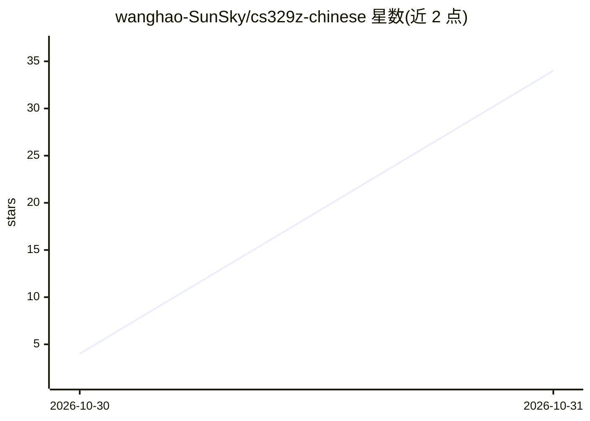

# wanghao-SunSky/cs329z-chinese

⭐ 34 · HTML · 推送 2026-10-28 · [GitHub](https://github.com/wanghao-SunSky/cs329z-chinese) · [官网](https://cs329z-course-review-20261029.wanghao162263.chatgpt.site) · 个人维护 · 中文 README

**Stanford CS329Z 中文教程：19 讲学会构建与评测 AI Agent**

围绕 Stanford CS329Z 公开材料整理的中文自学教程，面向会 Python 与基本 API 调用的开发者。内容含 19 讲中文教程，覆盖 LLM、RAG、工具调用、Agent 记忆、多 Agent 协作、评测与安全，配 4 项实战练习与 HW1 代码导读。提供 Markdown 源文件、支持搜索/目录/深浅主题的网页版及单文件离线 HTML；本地重建需 Node.js 18+ 与 Python 3。声明为独立整理资料，非 Stanford 官方中文版。

## 筛选速览

| 维度 | 判定 | 备注 |
|---|---|---|
| AI 角色 | `ai-knowledge` | 知识聚合/清单类 |
| 许可风险 | `none` | — |
| 部署形态 | `None` |  |
| 模型依赖 | — | README 未给出锁定关系 |
| 硬件要求 | — | 无带数字的原话,不猜 |
| 安装摩擦 | `low` | 无编译、无系统依赖或容器化 |
| 成熟度 | — | 结构信号不足 |

## 能力要点

- 19 讲中文教程覆盖 LLM、RAG、工具调用、记忆、多 Agent 与安全
- 4 项实战练习与 HW1 配套代码导读
- 支持搜索、目录、深浅主题的网页及单文件离线版
- 提供构建脚本（Node.js 18+ 与 Python 3）本地重新生成站点

## 适用场景

- 系统学习 AI Agent 的构建、评测与改进方法
- 按 19 讲路线从零搭建并评测自己的 Agent
- 离线阅读或本地构建教程站点

## 场景标签

`教程课程` · 领域:学习与行业

## 证据(README 行号)

> L3: 一套面向 Python 开发者的 AI Agent 自学教程。围绕 Stanford CS329Z 的公开材料，用中文讲解如何构建、评测和改进 Agent：从大语言模型、RAG、工具调用，到记忆、多 Agent 协作和安全防护。
> L13: |19 讲中文教程|从第 1 讲开始|

## 星数曲线

2026-10-30 4 → 2026-10-31 34（+30）

---
*卡片 v1 · prompt 1.4 · 生成 2026-10-30 · 置信度 high · 依据 README sha `2c40a0dd9177` · [字段定义](../../DATASET.md)*
