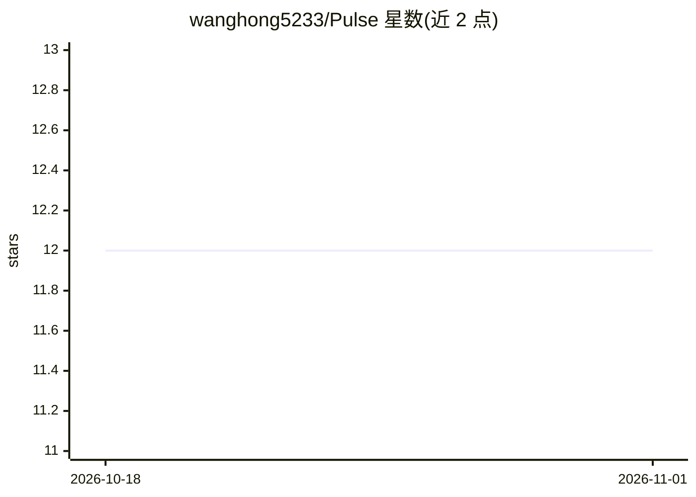

# wanghong5233/Pulse

⭐ 12 · Python · 推送 2026-04-30 · [GitHub](https://github.com/wanghong5233/Pulse) · 个人维护 · 中文 README

**自托管长驻个人 AI 助手：内核+技能包架构的 Agent OS**

部署在用户自己机器上的长驻个人 AI 助手（JARVIS 式）：领域无关的 Agent 内核（AgentRuntime 巡检调度、Layer×Scope 双轴记忆、三契约工具调用、SafetyPlane 四步 HITL、EventBus 审计）与按目录挂载的技能包分离。已落地求职（BOSS 直聘扫描/打招呼/HR 自动回复）、情报订阅、邮件追踪技能包，通过 MCP Server/Client 与 Claude Desktop、Cursor 互通。技术栈 Python 3.11 + FastAPI + PostgreSQL + Patchright，需 OpenAI 或 Qwen3-Max API Key。项目自述处于 v0 早期阶段，大量方向（游戏自动化、生活助手等）仍在 Roadmap 中未实现。

## 筛选速览

| 维度 | 判定 | 备注 |
|---|---|---|
| AI 角色 | `ai-native` | 本体是模型或模型工具 |
| 许可风险 | `none` | — |
| 部署形态 | `self-host` | docker 或自建部署 |
| 模型依赖 | — | README 未给出锁定关系 |
| 硬件要求 | — | 无带数字的原话,不猜 |
| 安装摩擦 | `low` | 无编译、无系统依赖或容器化 |
| 成熟度 | `idea` | |

## 能力要点

- 内核/技能包分离：AgentRuntime 长驻调度 + patrol 自注册巡检
- 三契约工具调用约束 Agent 幻觉，SafetyPlane 提供 Allow/Deny/Ask 授权闸门
- Layer × Scope 双轴记忆（无向量库，LLM 关键词 + SQL 检索）
- MCP Server + Client 双向互通，可被 Claude Desktop / Cursor 调用

## 适用场景

- 自动化求职：扫描 BOSS 直聘 JD、主动打招呼、自动回复 HR 并发简历
- 按主题订阅情报 RSS/GitHub Trending 并生成日报
- IMAP 邮件分类抽取面试邀请与日程
- 自托管一个跨会话持久记忆的个人 AI 助手

## 场景标签

`AI 助手` `浏览器自动化` `Agent 框架` · 领域:Agent 开发

## 证据(README 行号)

> L31: Pulse 是一个**部署在你自己机器上的个人 AI 助手** —— 长期驻留、真正理解你、帮你承担日常琐事。目标是做一个"你自己的 JARVIS":不是一次性的对话机器人,而是一个会主动执行、持续学习、越用越懂你的长驻系统。
> L37: - **已落地技能包**:求职(BOSS 扫 JD / 主动打招呼 / HR 对话自动回复 / 发简历)、情报订阅(多主题 YAML 装配的六步流水线 + 跨主题检索)、邮件追踪(IMAP 分类 + 日程抽取)。

## 星数曲线

2026-10-18 12 → 2026-11-01 12（+0）

---
*卡片 v1 · prompt 1.4 · 生成 2026-10-31 · 置信度 high · 依据 README sha `ba10a533efce` · [字段定义](../../DATASET.md)*
