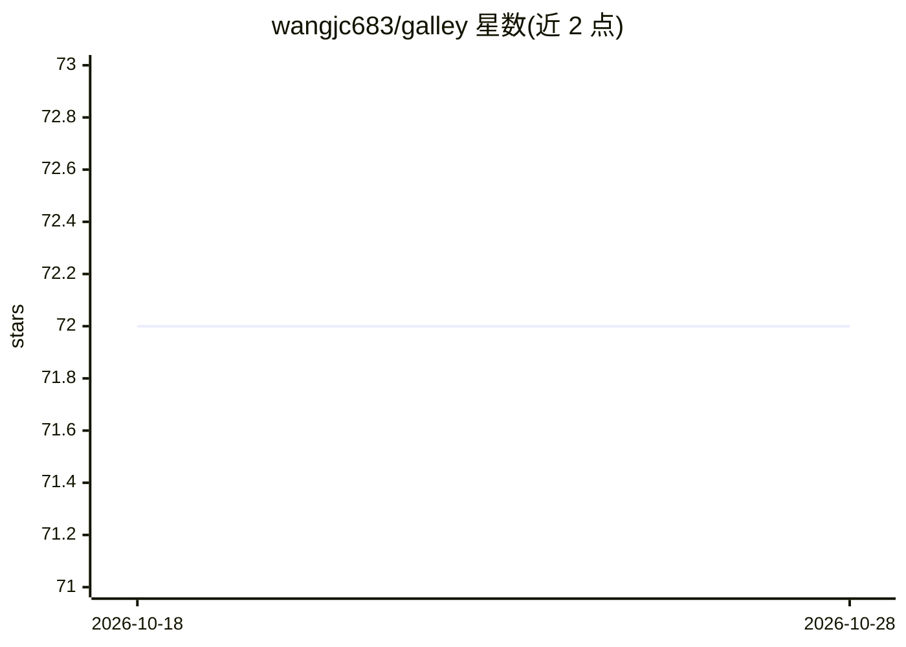

# wangjc683/galley

⭐ 72 · TypeScript · MIT · 推送 2026-10-28 · [GitHub](https://github.com/wangjc683/galley) · 个人维护 · 中文 README

**本地优先的桌面个人 AI 助理，操作终端、文件与浏览器完成任务**

运行在用户自己电脑上的 Tauri+Rust 桌面 AI 助理：通过主对话分派子任务到工作台，可执行终端命令、文件操作、键鼠控制、屏幕视觉，并经浏览器扩展操作用户已登录的 Chrome/Edge。支持接入任意模型（ChatGPT 账号登录或 API Key，含 Ollama 本地模型），任务解法沉淀为可复用技能，记忆与数据留在本机。附带 galley CLI 供 Claude Code 等外部 agent 作为 Supervisor 接入；macOS/Windows 提供安装包，iPhone 应用开发中。

## 筛选速览

| 维度 | 判定 | 备注 |
|---|---|---|
| AI 角色 | `ai-native` | 本体是模型或模型工具 |
| 许可风险 | `permissive` | MIT |
| 部署形态 | `desktop` | 安装包/桌面程序 |
| 模型依赖 | local-ok | 支持本地模型 |
| 硬件要求 | — | 无带数字的原话,不猜 |
| 安装摩擦 | `low` | 无编译、无系统依赖或容器化 |
| 成熟度 | — | 结构信号不足 |

## 能力要点

- 系统级执行：终端、文件、键鼠、屏幕视觉、ADB 手机
- 操作已登录浏览器的扩展，无需重新登录
- 任意模型接入：内置多家预设，兼容 OpenAI/Anthropic 端点及 Ollama 本地模型
- galley CLI 供 Claude Code/Codex 等外部 agent 作为 Supervisor 共用会话

## 适用场景

- 在本机用自然语言完成订票、查单、填表等日常任务
- 把长任务交给子任务工作台并行执行并汇报结果
- 让 Claude Code 等外部 agent 通过 CLI 接管和分派任务

## 场景标签

`AI 助手` `GUI 自动化` `浏览器自动化` · 领域:效率与自动化

## 证据(README 行号)

> L25: **Galley is a personal assistant that runs on your own computer.**
> L27: - **It does the work** — terminal, files, and the browser you're already signed into: booking tickets, checking ord
> L45: - 🖥️ **System-level execution** — terminal, files, keyboard and mouse, screen vision, even a phone over ADB: from l

## 星数曲线

2026-10-18 72 → 2026-10-28 72（+0）

---
*卡片 v1 · prompt 1.4 · 生成 2026-10-24 · 置信度 high · 依据 README sha `1a46e6384dbf` · [字段定义](../../DATASET.md)*
