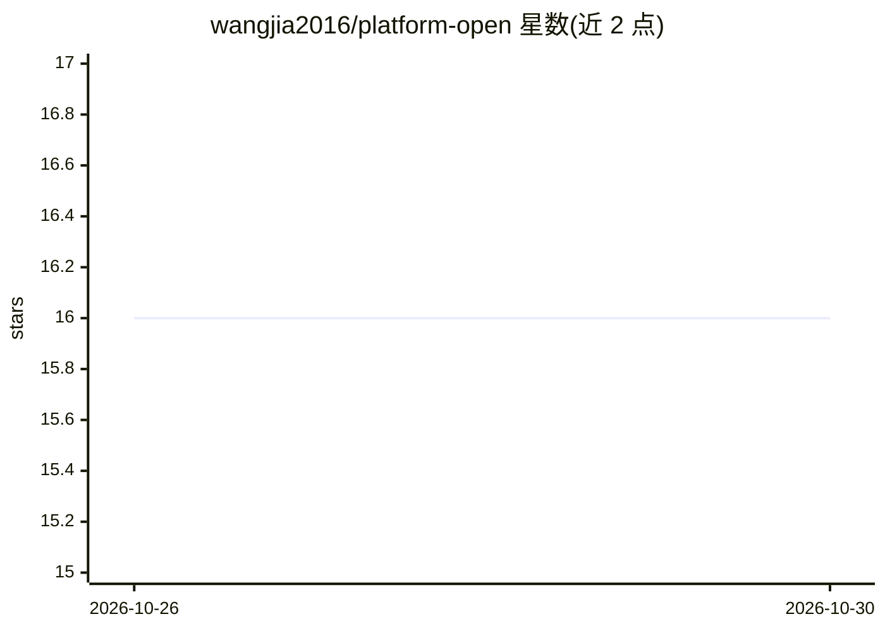

# wangjia2016/platform-open

⭐ 16 · Java · Apache-2.0 · 推送 2026-10-27 · [GitHub](https://github.com/wangjia2016/platform-open) · 个人维护 · 中文 README

**Spring Cloud Alibaba 商城/秒杀微服务实践工程，AI 为可选模块**

基于 Spring Boot 2.3 / Hoxton 的微服务示例工程，核心链路来自已上线业务：Redis Lua 原子预扣防超卖、RocketMQ 异步落单削峰、Redisson 锁基建、支付回调幂等与订单状态机，整合 Nacos / Feign / Sentinel / MyBatis。AI 为仓内独立模块 platform-ai，提供商城场景的自然语言搜索计划、候选重排推荐、单品分析与文案草稿、秒杀场次策划；默认规则降级，配置 AI_ENABLED 与 AI_API_KEY 后走 OpenAI 兼容 LLM，秒杀主链路不经 AI。Gateway 为独立仓库，版本钉在 Boot 2.3。

## 筛选速览

| 维度 | 判定 | 备注 |
|---|---|---|
| AI 角色 | `ai-enhanced` | 去掉 AI 部分产品仍成立 |
| 许可风险 | `permissive` | Apache-2.0 |
| 部署形态 | `self-host` | docker 或自建部署 |
| 模型依赖 | — | README 未给出锁定关系 |
| 硬件要求 | — | 无带数字的原话,不猜 |
| 安装摩擦 | `low` | 无编译、无系统依赖或容器化 |
| 成熟度 | — | 结构信号不足 |

## 能力要点

- Redis Lua 原子预扣库存 + RocketMQ 异步落单的秒杀主链路
- platform-ai 独立模块：默认规则降级，配置密钥后走 OpenAI 兼容 LLM
- 支付回调乐观锁幂等与订单状态机
- docker compose 一键拉起本地依赖，QUICKSTART curl 验证

## 适用场景

- 对照真实秒杀链路做二次开发或源码研读
- 在商城场景中接入可选的 AI 搜索/推荐/文案能力
- 学习 Spring Cloud Alibaba 微服务整合实践

## 场景标签

`AI 写作` `推荐系统` · 领域:内容生成

## 证据(README 行号)

> L38: |AI|`platform-ai`：搜索计划 / 推荐 / 分析 / 场次策划，热路径不经 AI|少见|
> L54: - **架构与是否独立服务：** docs/ai/ARCHITECTURE.md — 结论为仓内独立模块 `platform-ai`，mall Feign 调用；秒杀主链路不经过 AI
> L55: - **第二期（已落地）：** 模块 `platform-ai`（8088）+ 门面 `/mall/api/ai/v1/*`；默认规则降级，`AI_ENABLED`+`AI_API_KEY` 后走模型

## 星数曲线

2026-10-26 16 → 2026-10-30 16（+0）

---
*卡片 v1 · prompt 1.4 · 生成 2026-10-30 · 置信度 high · 依据 README sha `8d8a6553a77f` · [字段定义](../../DATASET.md)*
