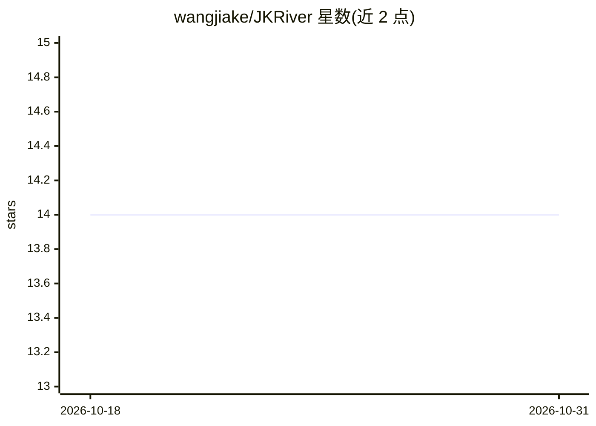

# wangjiake/JKRiver

⭐ 14 · Python · NOASSERTION · 推送 2026-07-24 · [GitHub](https://github.com/wangjiake/JKRiver) · [官网](https://wangjiake.github.io/riverse-docs/) · 个人维护 · 中文 README

**本地优先的个人 AI 记忆引擎与随身 Agent**

个人记忆引擎：每次对话后运行 14 步离线整合管道（Sleep），抽取事实/关系/事件，进行置信度升级、时间衰减、矛盾仲裁与知识图谱构建，形成结构化个人画像；数据存于本地 PostgreSQL。内置个人 Agent，支持 Web/Telegram/Discord 多通道、多模态输入、工具调用、MCP 协议与外部 Agent 接入。本地 LLM 走 Ollama，云端走任意 OpenAI 兼容 API。支持家庭多用户隔离，REST API（8400 端口）无鉴权，不可暴露公网。许可为 AGPL-3.0 + Commercial 双许可。

## 筛选速览

| 维度 | 判定 | 备注 |
|---|---|---|
| AI 角色 | `ai-native` | 本体是模型或模型工具 |
| 许可风险 | `dual` | NOASSERTION |
| 部署形态 | `self-host` | docker 或自建部署 |
| 模型依赖 | local-ok | 支持本地模型 |
| 硬件要求 | — | 无带数字的原话,不猜 |
| 安装摩擦 | `low` | 无编译、无系统依赖或容器化 |
| 成熟度 | — | 结构信号不足 |

## 能力要点

- 14 步原子事务的记忆整合管道（抽取/交叉验证/矛盾仲裁/知识图谱）
- 事实置信度生命周期：suspected→confirmed→established，含 TTL 衰减与失效链
- 多通道个人 Agent：Web/Telegram/Discord/REST/CLI，支持工具、MCP、外部 Agent 接入
- 本地优先，数据存本地 PostgreSQL；Ollama 或任意 OpenAI 兼容 API 均可

## 适用场景

- 让个人 AI 助手跨对话记住我的生活脉络并主动关联
- 部署在自家设备上、数据不出本地的家庭多成员 AI 助手
- 通过 REST API 把个人记忆画像接入外部系统或 Agent

## 场景标签

`AI 助手` `Agent 记忆` `知识图谱` · 领域:Agent 开发

## 证据(README 行号)

> L5: **Personal memory engine for AI — extracts, ages, and resolves your memories from every conversation. Runs locally. 
> L196: |Local LLM|Ollama (any compatible model)|

## 星数曲线

2026-10-18 14 → 2026-10-31 14（+0）

---
*卡片 v1 · prompt 1.4 · 生成 2026-10-31 · 置信度 mid · 依据 README sha `8d0f40aefdaf` · [字段定义](../../DATASET.md)*
