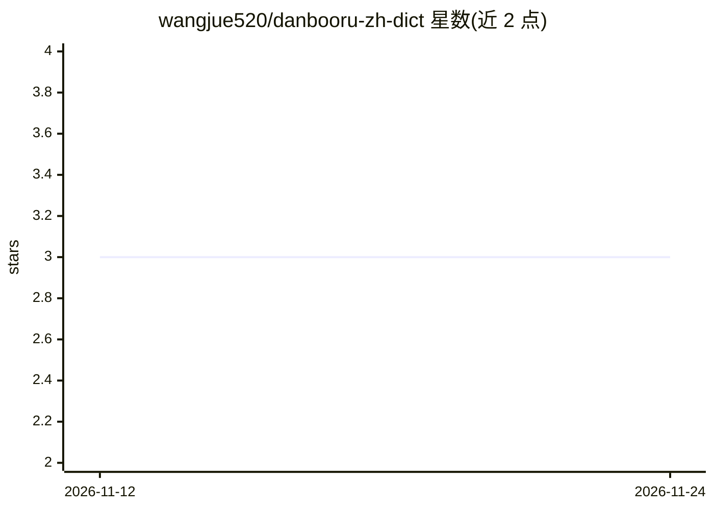

# wangjue520/danbooru-zh-dict

⭐ 3 · Python · NOASSERTION · 推送 2026-10-08 · [GitHub](https://github.com/wangjue520/danbooru-zh-dict) · 个人维护 · 中文 README

**AI 绘画用户的 Danbooru 标签中英字典（12.6 万条）**

收录 Danbooru 图数 ≥50 的 125,778 个标签，每个标签含中文译名、中文同义词、英文/日文别名、提示词写法与一句话说明，按通用/角色/作品/画师/元标签五类组织。以 CSV（Excel 可直接打开）、JSON 字典与中文反查表三种文件分发，支持中文查标签与英译中。译名底稿来自开源数据，用大模型纠正误译并扩展同义词；冷门角色/作品可能有误。含成人内容标签翻译，MIT 许可发布，另附用 LLM 重新生成的脚本。

## 筛选速览

| 维度 | 判定 | 备注 |
|---|---|---|
| AI 角色 | `ai-knowledge` | 知识聚合/清单类 |
| 许可风险 | `none` | NOASSERTION |
| 部署形态 | `library` | 以包/库形式分发 |
| 模型依赖 | locked-api |  |
| 硬件要求 | — | 无带数字的原话,不猜 |
| 安装摩擦 | `low` | 无编译、无系统依赖或容器化 |
| 成熟度 | — | 结构信号不足 |

## 能力要点

- 125,778 个标签的中文译名、同义词与别名，按五类组织
- 提供 CSV/JSON/中文反查表三种格式，反查表含 30.6 万中文词
- 附带用大模型重新生成字典的脚本，支持断点续跑与人工修正文件
- 配套 sd-webui-zh-tag-autocomplete WebUI 插件

## 适用场景

- 用中文关键词反查 Danbooru 英文标签写提示词
- 给 AI 绘画提示词工具、打标器接入中文显示与自动补全
- 查某个英文标签的中文含义与常见写法

## 场景标签

`图像生成` · 领域:内容生成

## 证据(README 行号)

> L3: Danbooru 标签**中英字典**：收录 Danbooru 图数 ≥50 的 **125,778** 个标签（2026-10 数据），每个标签都有中文译名、中文同义词、英文/日文别名和一句说明。
> L8: - 做 AI 绘画提示词工具、打标器的中文显示、自动补全插件
> L59: - 中文底稿来自 amenorira/danbooru-tags-data-zh，在此基础上用大模型纠正误译、扩展同义词。例如 `cowboy_shot` 原译「牛仔像」改为「七分身构图」，`censored` 原译「送审的」改为

## 星数曲线

2026-11-12 3 → 2026-11-24 3（+0）

---
*卡片 v1 · prompt 1.4 · 生成 2026-11-22 · 置信度 mid · 依据 README sha `ed3fc0d1fa0d` · [字段定义](../../DATASET.md)*
