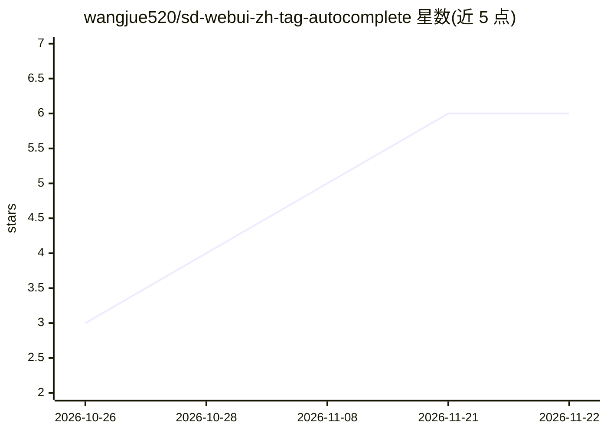

# wangjue520/sd-webui-zh-tag-autocomplete

⭐ 6 · JavaScript · NOASSERTION · 推送 2026-11-14 · [GitHub](https://github.com/wangjue520/sd-webui-zh-tag-autocomplete) · 个人维护 · 中文 README

**给 SD WebUI 用户的中文打标扩展：中文补全 Danbooru 标签并中译英**

面向 A1111 系 Stable Diffusion WebUI（含 Forge/Forge Neo）的扩展插件：在提示词框输入中文即弹出对应 Danbooru 英文标签候选，支持一键中译英、提示词中文预览与双向同步。收录图数≥50 的 125,778 个标签，含角色译名与口语化同义词，按完全/开头/包含/模糊匹配排序。词典未覆盖的中文可调用谷歌翻译或 DeepSeek 兜底；断网时自动进入纯本地模式 60 秒。无 Python 依赖，经 WebUI 扩展页、git clone 或 ZIP 解压安装。

## 筛选速览

| 维度 | 判定 | 备注 |
|---|---|---|
| AI 角色 | `ai-enhanced` | 去掉 AI 部分产品仍成立 |
| 许可风险 | `none` | NOASSERTION |
| 部署形态 | `None` |  |
| 模型依赖 | — | README 未给出锁定关系 |
| 硬件要求 | — | 无带数字的原话,不猜 |
| 安装摩擦 | `low` | 无编译、无系统依赖或容器化 |
| 成熟度 | — | 结构信号不足 |

## 能力要点

- 125,778 个 Danbooru 标签带中文名与多同义词，模糊匹配口语说法
- 一键中译英保留权重语法与 LoRA 标记，快捷键 Alt+T
- 提示词中文预览与提示词框双向同步、可点击删除
- 针对中文输入法处理拼音过程中的候选弹出与残留替换

## 适用场景

- 用中文输入法直接写 SD 提示词，弹出英文标签补全
- 把整段中文提示词一键转成英文标签
- 核对现有英文提示词对应的中文含义

## 场景标签

`图像生成` · 领域:内容生成

## 证据(README 行号)

> L3: SD WebUI 中文标签补全扩展：在提示词框里**直接打中文**，弹出对应的 Danbooru 英文标签供选择；也可以把整段中文提示词**一键翻译**成标签。
> L10: - 适用于 A1111 系 WebUI：Stable Diffusion WebUI、Forge、Forge Neo
> L121: |字典里没有的中文用机器翻译|开|由 WebUI 后端请求翻译，浏览器不直接访问|

## 星数曲线

2026-10-26 3 → 2026-11-22 6（+3）

---
*卡片 v1 · prompt 1.4 · 生成 2026-11-21 · 置信度 high · 依据 README sha `714b7f047a2e` · [字段定义](../../DATASET.md)*
