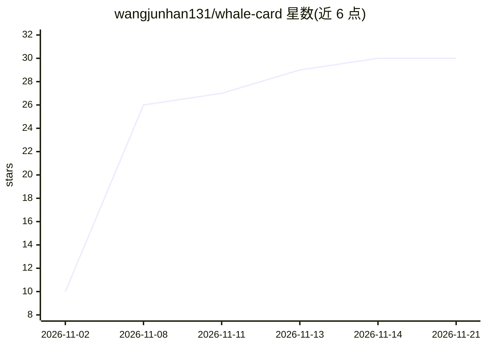

# wangjunhan131/whale-card

⭐ 30 · Python · MIT · 推送 2026-11-13 · [GitHub](https://github.com/wangjunhan131/whale-card) · 个人维护 · 中文 README

**给陪伴型 AI 的便携记忆卡：遗忘曲线与身份校验**

以本地 Python 服务（127.0.0.1:8848 HTTP）形式运行的持久化记忆与人格卡，供陪伴型 AI agent 通过桥接脚本读取上下文、上报对话。核心机制包括：三级记忆池与分段双速率衰减（半衰期参数可查）、六类分区差异化遗忘、哈希链时间线与 verify_chain 自证连续性、6 条身份锚 sha256 启动校验、离线超 24 小时自动补记。依赖 Python 3.10+、numpy 与本地 bge-base-zh-v1.5 嵌入模型，Windows/Linux 均可运行。许可声明仅供特定使用者使用，禁止复制分发。

## 筛选速览

| 维度 | 判定 | 备注 |
|---|---|---|
| AI 角色 | `ai-ecosystem` | LLM/agent 周边工具 |
| 许可风险 | `permissive` | MIT |
| 部署形态 | `library` | 以包/库形式分发 |
| 模型依赖 | — | README 未给出锁定关系 |
| 硬件要求 | — | 无带数字的原话,不猜 |
| 安装摩擦 | `low` | 无编译、无系统依赖或容器化 |
| 成熟度 | — | 结构信号不足 |

## 能力要点

- 三级记忆池 + 六类分区衰减的真实遗忘曲线机制
- 哈希链时间线可自证未被篡改、未被跳号
- 6 条身份事实 sha256 启动校验，防误加载他人卡
- 22 项回归测试与只读体检脚本

## 适用场景

- 让陪伴型 AI 在换窗口、换电脑后保持人格与记忆连续
- 为长期对话 agent 提供带遗忘与巩固的记忆召回
- 校验记忆卡完整性并排查坏库现场

## 场景标签

`Agent 记忆` · 领域:Agent 开发

## 证据(README 行号)

> L19: - 心智服务常驻本地 HTTP（127.0.0.1:8848），DSH 每轮**必须先来问它**要上下文
> L13: 一张**真正能随身带走的记忆卡**。
> L36: - Python 3.10+（标准库 + `numpy`）

## 星数曲线

2026-11-02 10 → 2026-11-21 30（+20）

---
*卡片 v1 · prompt 1.4 · 生成 2026-11-21 · 置信度 mid · 依据 README sha `f7f21ab8d3fc` · [字段定义](../../DATASET.md)*
