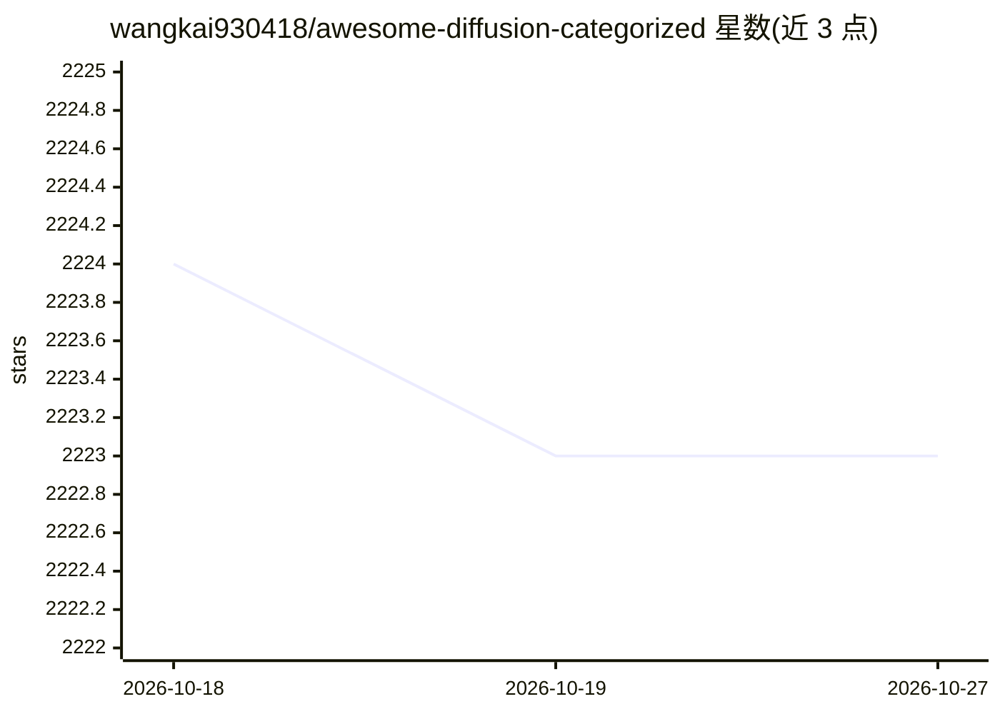

# wangkai930418/awesome-diffusion-categorized

⭐ 2,223 · 推送 2026-03-16 · [GitHub](https://github.com/wangkai930418/awesome-diffusion-categorized) · 个人维护

**按子领域分类的扩散模型论文清单，供研究者检索**

个人维护的扩散模型论文策展清单：按 Illusion（视觉错觉）、Color in Generation（颜色生成）、Count Guidance（计数引导）、Poster（海报生成）、Accelerate（加速/蒸馏）等子领域组织条目，每条含论文标题、发表会议（CVPR/ICCV/ECCV/NeurIPS/ICML/ICLR 等）以及 Project/Code/Website 链接。其中 Accelerate 类收录条目最多，覆盖一致性蒸馏、缓存加速、单步生成等方向。README 未提供安装方式，内容为静态 Markdown 列表，目录部分在展示中被省略。

## 筛选速览

| 维度 | 判定 | 备注 |
|---|---|---|
| AI 角色 | `ai-knowledge` | 知识聚合/清单类 |
| 许可风险 | `none` | — |
| 部署形态 | `None` |  |
| 模型依赖 | — | README 未给出锁定关系 |
| 硬件要求 | — | 无带数字的原话,不猜 |
| 安装摩擦 | `low` | 无编译、无系统依赖或容器化 |
| 成熟度 | — | 结构信号不足 |

## 能力要点

- 按扩散模型子领域（错觉/颜色/计数/海报/加速）分类组织论文条目
- 每条目标注发表会议及 Project/Code 链接
- 加速类收录约百条，覆盖蒸馏与缓存加速方向

## 适用场景

- 查找特定子方向的扩散模型论文及代码
- 跟踪扩散加速/蒸馏方向的会议论文产出
- 按主题浏览扩散模型研究脉络

## 场景标签

`精选清单` · 领域:学习与行业

## 证据(README 行号)

> L1: # Awesome Diffusion Categorized
> L145: # Accelerate

## 星数曲线

2026-10-18 2,224 → 2026-10-27 2,223（-1）

---
*卡片 v1 · prompt 1.4 · 生成 2026-10-21 · 置信度 high · 依据 README sha `b556d5e3d89a` · [字段定义](../../DATASET.md)*
