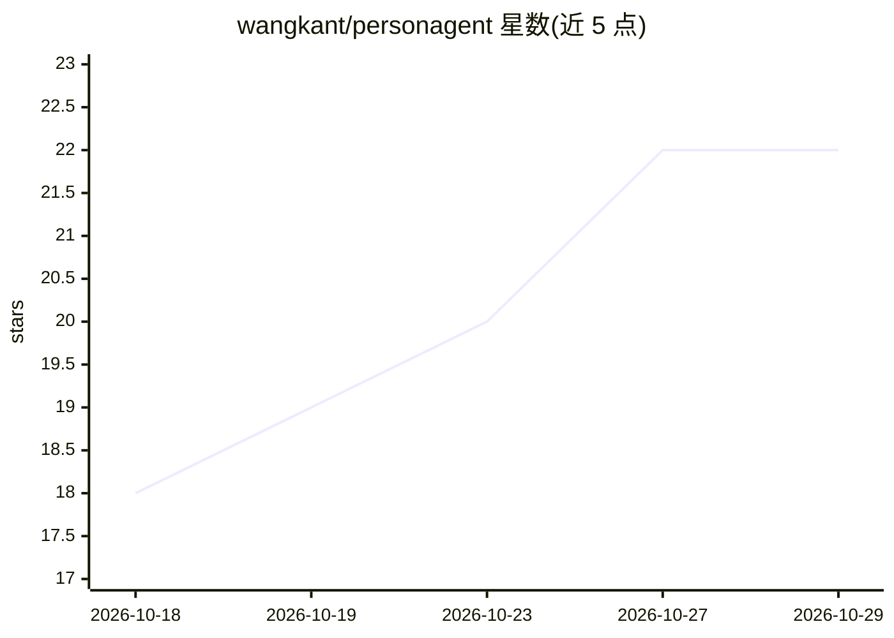

# wangkant/personagent

⭐ 22 · Python · MIT · 推送 2026-10-27 · [GitHub](https://github.com/wangkant/personagent) · 个人维护 · 中文 README

**会看时机发言、能从纠正中学习的群聊角色机器人**

面向群聊的角色型聊天机器人：运行在任意 OpenAI 兼容模型上，由模型判断是否插话而非随机掷骰，消息爆发合并为一条回复。核心机制是从群成员对回复的反应中学习（纠正需同群两个同意反应、其一为强反应才生效），每次变更记入证据台账并可回滚，附 `personagent eval` 评测脚本。自身直连 QQ、微信、Telegram、Discord，其余平台经由其下载并在后台托管的 AstrBot 接入，也可挂靠已运行的 AstrBot、Koishi（Satori）或 Matrix。以 pip 包安装，浏览器本地页面完成设置，数据全部存本机。

## 筛选速览

| 维度 | 判定 | 备注 |
|---|---|---|
| AI 角色 | `ai-native` | 本体是模型或模型工具 |
| 许可风险 | `permissive` | MIT |
| 部署形态 | `library` | 以包/库形式分发 |
| 模型依赖 | — | README 未给出锁定关系 |
| 硬件要求 | — | 无带数字的原话,不猜 |
| 安装摩擦 | `low` | 无编译、无系统依赖或容器化 |
| 成熟度 | — | 结构信号不足 |

## 能力要点

- 模型判定插话时机，消息爆发合并为一条回复
- 从群内纠正中学习：需两个同意反应（其一强反应）才生效，有台账与回滚
- 直连 QQ/微信/Telegram/Discord，其余平台经托管 AstrBot 或 Satori/Matrix 接入
- `personagent eval` 对发言时机、角色保持、纠正留存三项做盲评

## 适用场景

- 让一个角色机器人常驻自己的 QQ/Telegram/Discord 群
- 通过群成员反馈逐步教会机器人群内习惯（如称呼）
- 在已运行 AstrBot 或 Koishi 的环境里把本产品作为角色后端

## 场景标签

`聊天机器人` · 领域:对话与助手

## 证据(README 行号)

> L3:  A character for your group chats that knows when to stay quiet, and learns from being corrected.
> L12: personagent is a character for your group chats: pick one or write your own, and run it on any OpenAI-compatible mo

## 星数曲线

2026-10-18 18 → 2026-10-29 22（+4）

---
*卡片 v1 · prompt 1.4 · 生成 2026-10-27 · 置信度 high · 依据 README sha `c64c8e72a59c` · [字段定义](../../DATASET.md)*
