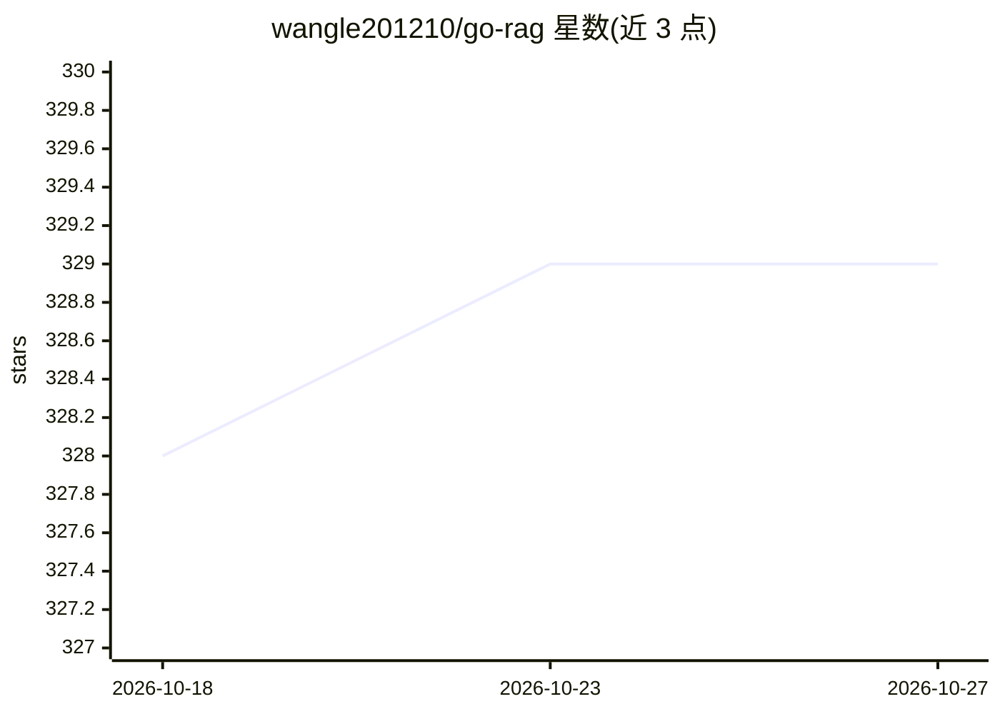

# wangle201210/go-rag

⭐ 329 · Go · Apache-2.0 · 推送 2026-09-14 · [GitHub](https://github.com/wangle201210/go-rag) · 个人维护 · 中文 README

**Go+Vue 实现的知识库 RAG 应用：上传文档、检索与对话**

基于 eino 框架、GoFrame 与 Vue 的知识库 RAG 系统：支持创建多知识库、上传文档（md/pdf/html/网页）、长文档自动切割与 chunk 编辑、自动生成 QA 对、多路召回（内容向量+QA 向量经 RRF 融合重排，ES 模式含 BM25）及对话；可选 You.com 联网检索，并提供 MCP 接入（以 deepchat 为例）。向量存储支持 ES8 与 qdrant，需 MySQL；提供 Docker Compose 快速启动与源码构建两种方式，另有跨平台 GUI 版 wachat 免去 docker 依赖。

## 筛选速览

| 维度 | 判定 | 备注 |
|---|---|---|
| AI 角色 | `ai-native` | 本体是模型或模型工具 |
| 许可风险 | `permissive` | Apache-2.0 |
| 部署形态 | `self-host` | docker 或自建部署 |
| 模型依赖 | — | README 未给出锁定关系 |
| 硬件要求 | — | 无带数字的原话,不猜 |
| 安装摩擦 | `low` | 无编译、无系统依赖或容器化 |
| 成熟度 | — | 结构信号不足 |

## 能力要点

- 多路召回：内容向量+QA 向量 RRF 融合重排，ES 模式增加 BM25 关键词召回
- 文档解析覆盖 md/pdf/html 与网页，支持 chunk 编辑与 QA 对自动生成
- 存储层支持 ES8 与 qdrant 存取向量数据
- MCP 集成（以 deepchat 为例）与可选 You.com 联网检索

## 适用场景

- 搭建团队私有知识库并进行文档问答
- 对上传文档做切割、编辑与检索验证
- 通过 MCP 将知识库接入 deepchat 等对话客户端

## 场景标签

`文档问答` `RAG` · 领域:知识与检索

## 证据(README 行号)

> L2: 基于eino+gf+vue实现知识库的rag
> L32: - [x] 多路召回（内容向量 + QA 向量，通过 RRF 融合后重排；ES 模式增加 BM25 关键词召回）

## 星数曲线

2026-10-18 328 → 2026-10-27 329（+1）

---
*卡片 v1 · prompt 1.4 · 生成 2026-10-21 · 置信度 mid · 依据 README sha `f0597ed8f7dd` · [字段定义](../../DATASET.md)*
