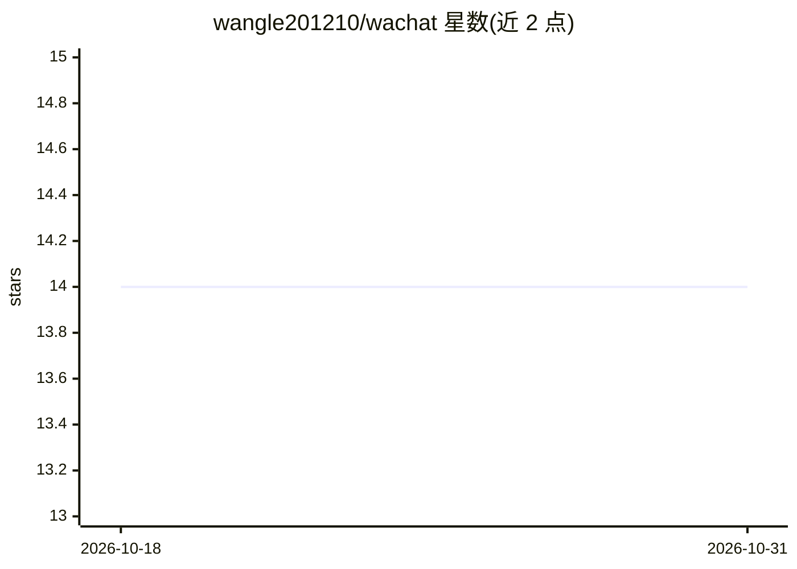

# wangle201210/wachat

⭐ 14 · Go · Apache-2.0 · 推送 2025-11-14 · [GitHub](https://github.com/wangle201210/wachat) · 个人维护 · 中文 README

**基于 Wails+Vue 3 的桌面 AI 聊天应用，多Tab对话带RAG**

面向终端用户的轻量级桌面 AI 聊天应用：Go(Wails)+Vue 3 技术栈，提供流式对话、多Tab会话管理、SQLite 本地持久化、Markdown/数学公式渲染。AI 接入采用 OpenAI 兼容 API，也支持 Ollama、Azure OpenAI 等兼容服务。RAG 功能集成 go-rag 与 Qdrant 向量数据库（首次使用自动下载服务），支持上传 PDF/Markdown/HTML/文本及抓取网页 URL 建立知识库。构建需 Go、Node.js、pnpm 与 Wails CLI 环境。

## 筛选速览

| 维度 | 判定 | 备注 |
|---|---|---|
| AI 角色 | `ai-native` | 本体是模型或模型工具 |
| 许可风险 | `permissive` | Apache-2.0 |
| 部署形态 | `library` | 以包/库形式分发 |
| 模型依赖 | local-ok | 支持本地模型 |
| 硬件要求 | — | 无带数字的原话,不猜 |
| 安装摩擦 | `low` | 无编译、无系统依赖或容器化 |
| 成熟度 | — | 结构信号不足 |

## 能力要点

- 多Tab会话管理与 SQLite 本地持久化
- RAG 知识库（go-rag + Qdrant，支持 PDF/MD/HTML/URL 文档）
- OpenAI 兼容 API 接入，可配 Ollama 等服务
- 流式输出与 Markdown/代码高亮/KaTeX 数学公式渲染

## 适用场景

- 在桌面端与多个 AI 服务进行多会话并行对话
- 上传自己的文档建立知识库做检索增强问答
- 用本地 Ollama 模型离线聊天

## 场景标签

`聊天机器人` `文档问答` · 领域:对话与助手

## 证据(README 行号)

> L3: 一个基于 Wails 框架和 Vue 3 的 AI 聊天应用，提供流畅的对话体验和多Tab会话管理功能。
> L16: - 🔌 **OpenAI 兼容** - 支持 OpenAI API 和其他兼容接口
> L18: - 📚 **RAG 知识库** - 集成 go-rag 和 Qdrant 向量数据库，支持文档检索增强对话

## 星数曲线

2026-10-18 14 → 2026-10-31 14（+0）

---
*卡片 v1 · prompt 1.4 · 生成 2026-10-31 · 置信度 high · 依据 README sha `fc728f9be8e0` · [字段定义](../../DATASET.md)*
