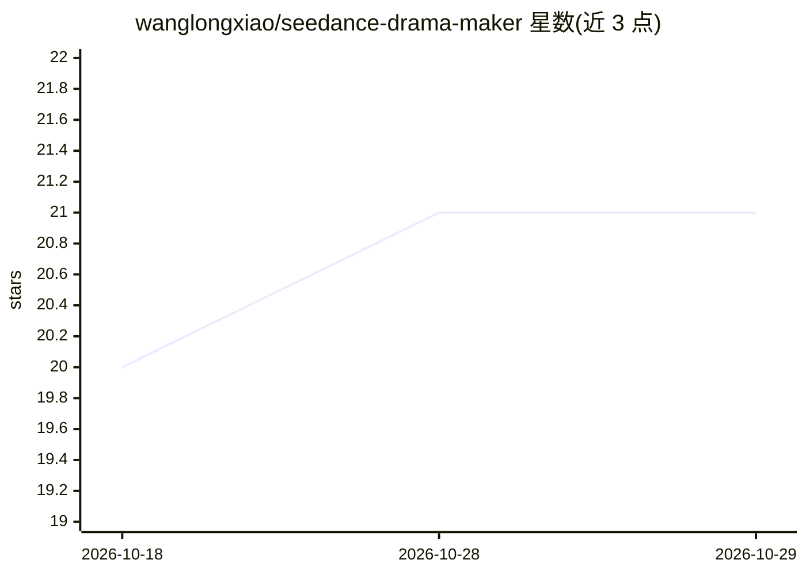

# wanglongxiao/seedance-drama-maker

⭐ 21 · Python · MIT · 推送 2026-10-27 · [GitHub](https://github.com/wanglongxiao/seedance-drama-maker) · 个人维护 · 中文 README

**多 Agent 全自动 AI 短剧生成系统：一句话产出成片**

基于 FastAPI + WebSocket 的多 Agent AI 视频制作系统，输入一句话/图片/语音，经剧本生成（ScriptAgent）、参考图库（ImageAgent，SeeDream-5.0-flash）、角色装扮与布景状态变体、分镜视频生成（VideoAgent，SeeDance-2.5）、AI 视觉审核与 FFmpeg 合成，产出 MP4 成片与字幕。依赖 BytePlus ModelArk / Seed-Speech / TOS 云服务与对应凭证，需 Python 3.11、Node 22+、Chromium、FFmpeg。支持本地运行与 veFaaS 云端部署，界面支持五种语言，视频对白支持 14 种语言。

## 筛选速览

| 维度 | 判定 | 备注 |
|---|---|---|
| AI 角色 | `ai-native` | 本体是模型或模型工具 |
| 许可风险 | `permissive` | MIT |
| 部署形态 | `self-host` | docker 或自建部署 |
| 模型依赖 | locked-api |  |
| 硬件要求 | — | 无带数字的原话,不猜 |
| 安装摩擦 | `low` | 无编译、无系统依赖或容器化 |
| 成熟度 | — | 结构信号不足 |

## 能力要点

- 多 Agent 流水线：剧本→参考图→分镜视频→审核→合成一站式闭环
- 单镜头 5–30 秒、最多 50 个参考输入、成片上限 3600 秒
- 角色装扮/布景状态变体图自动派生并跨分镜一致引用
- 分镜视频 AI 审核（通过阈值 80、重试上限 2）与局部修复

## 适用场景

- 一句话需求自动生成短剧、漫剧或广告成片
- 上传人物/布景参考图保持跨镜头角色一致性
- 语音输入创作需求并自动转文字生成剧本

## 场景标签

`视频生成` `多智能体` · 领域:Agent 开发

## 证据(README 行号)

> L13: 由 **SeeDance 2.5** 视频模型驱动，一句话即可产出电影级 AI 短剧：
> L24: 多 Agent AI 视频制作系统，支持文字、图片或语音输入，自动或手动生成短剧、漫剧与广告，可在本地和云端运行。

## 星数曲线

2026-10-18 20 → 2026-10-29 21（+1）

---
*卡片 v1 · prompt 1.4 · 生成 2026-10-28 · 置信度 mid · 依据 README sha `fbff90e1d7c0` · [字段定义](../../DATASET.md)*
