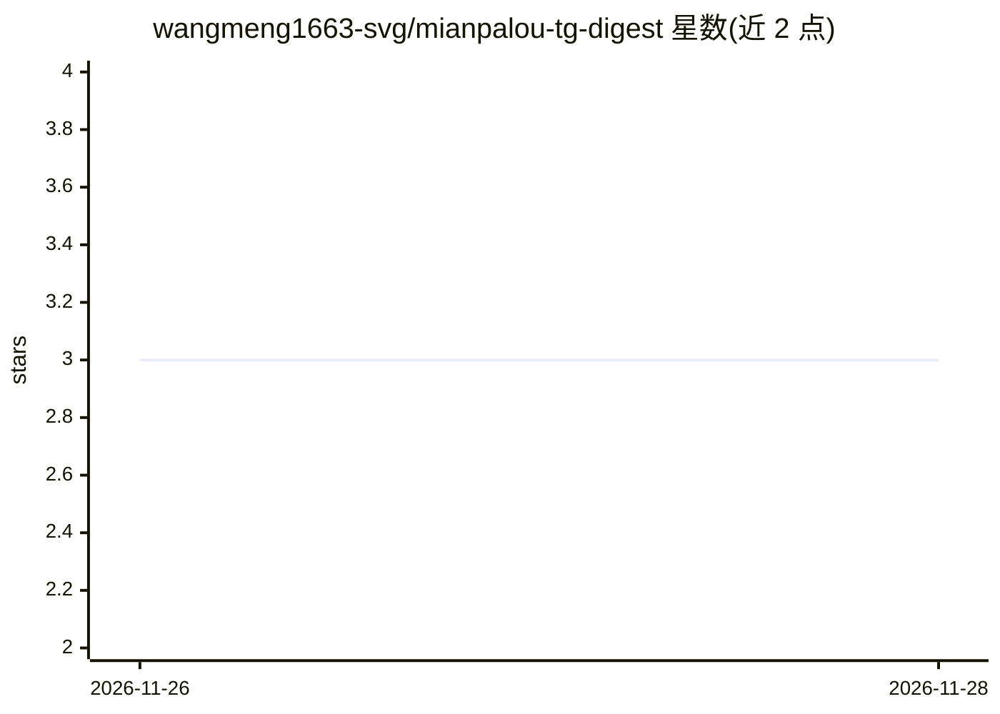

# wangmeng1663-svg/mianpalou-tg-digest

⭐ 3 · Python · MIT · 推送 2026-10-29 · [GitHub](https://github.com/wangmeng1663-svg/mianpalou-tg-digest) · [官网](https://t.me/qunribaobot) · 个人维护 · 中文 README

**自部署 TG 群日报机器人：每天把 24h 群聊精炼成一张长图**

面向 Telegram 群组的日报机器人：以透明成员身份收群消息（SQLite 暂存），每天当地 20:00 将过去 24 小时消息交给 LLM 生成结构化总结，填入 HTML 模板后用 Chromium 截图为 1080px 长图发回群里，随后删除原始消息（只留统计数字）。零配置拉进群即用，按群语言自动出中英文日报；内置转述规则（不站队、红线跳过、不 @ 任何人）。限制：收不到入群前历史与其他 bot 消息，消息发出前需暂存数小时。提供在线版与自部署两条路径。

## 筛选速览

| 维度 | 判定 | 备注 |
|---|---|---|
| AI 角色 | `ai-enhanced` | 去掉 AI 部分产品仍成立 |
| 许可风险 | `permissive` | MIT |
| 部署形态 | `library` | 以包/库形式分发 |
| 模型依赖 | — | README 未给出锁定关系 |
| 硬件要求 | — | 无带数字的原话,不猜 |
| 安装摩擦 | `low` | 无编译、无系统依赖或容器化 |
| 成熟度 | — | 结构信号不足 |

## 能力要点

- 24h 群聊 → LLM 结构化总结 → Chromium 截图为 1080px 日报长图
- 看完即焚：日报发出后立即删除全部原始消息
- 自动适配时区与群语言，中文群出中文、英文群出英文
- 零配置：拉进群即工作，无需管理员权限

## 适用场景

- 群太多爬不动楼，每天一张图看完 24 小时精华
- 自部署私有日报 bot，聊天数据发完即焚
- 多语言群组各自生成对应语言的日报

## 场景标签

`聊天机器人` · 领域:对话与助手

## 证据(README 行号)

> L5: 把机器人拉进群，每天自动把过去 24 小时的群聊精炼成一张日报长图发回群里。
> L52:   → 每天当地 20:00，把 24h 消息交给 LLM
> L58: AI 只负责产内容，版面由模板锁死，样式永远统一。

## 星数曲线

2026-11-26 3 → 2026-11-28 3（+0）

---
*卡片 v1 · prompt 1.4 · 生成 2026-11-26 · 置信度 high · 依据 README sha `c1b43ed75c96` · [字段定义](../../DATASET.md)*
