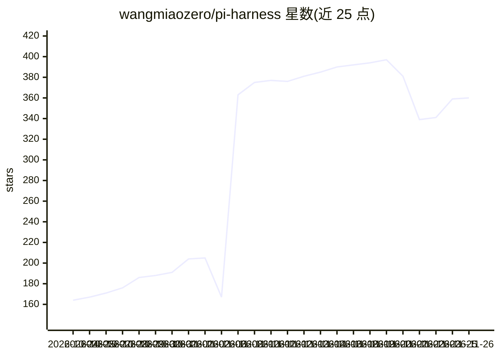

# wangmiaozero/pi-harness

⭐ 360 · TypeScript · AGPL-3.0 · 推送 2026-11-25 · [GitHub](https://github.com/wangmiaozero/pi-harness) · [官网](https://wangmiaozero.github.io/pi-harness-website/) · 个人维护 · 中文 README

**Pi Coding Agent 的桌面运维工作台：观测、治理与多 Agent 编排**

围绕 Pi Coding Agent 构建的 Electron 桌面应用，Pi 本体继续负责 agent 循环、会话、上下文、工具与模型执行，Pi-Harness 在其上提供可视化工作区：运行记录、Trace、Replay、评估与回归基线，策略与预算控制、检查点与恢复（resume/fork/retry），以及基于任务 DAG、模板与 Worktree 隔离的多 Agent 团队编排。另聚合 Claude Code、Codex、Cursor、Gemini CLI 等会话历史，提供项目架构图与文件/Git 工具。安装包捆绑 Pi 与 Node.js，覆盖 macOS/Windows/Linux。

## 筛选速览

| 维度 | 判定 | 备注 |
|---|---|---|
| AI 角色 | `ai-ecosystem` | LLM/agent 周边工具 |
| 许可风险 | `viral` | AGPL-3.0 |
| 部署形态 | `desktop` | 安装包/桌面程序 |
| 模型依赖 | — | README 未给出锁定关系 |
| 硬件要求 | — | 无带数字的原话,不猜 |
| 安装摩擦 | `low` | 无编译、无系统依赖或容器化 |
| 成熟度 | — | 结构信号不足 |

## 能力要点

- 运行记录、Trace、Replay、Run Compare 与评估回归，从记录证据排查失败
- 策略与预算控制、检查点恢复（resume/fork/retry）
- 多 Agent 团队：任务 DAG、结果传递、Review Gate 与 Worktree 隔离
- 聚合 Claude Code/Codex/Cursor/Gemini CLI/Pi 的会话历史，浏览与检索不消耗模型 token

## 适用场景

- 在真实项目中查看并操控 Pi agent 每次运行的工具活动与结果
- 给 agent 设置工具权限与花费上限，出错后从检查点恢复
- 把大任务拆给多个 Pi agent 并行/串行协作并保持改动隔离
- 统一检索多个编码 agent 工具的历史会话

## 场景标签

`多智能体` `LLM 可观测性` · 领域:Agent 开发

## 证据(README 行号)

> L3: ### The Operational Superset of Pi Coding Agent
> L29: - **Stay on native Pi**: Pi runs the agent loop, sessions, context, tools, models and thinking. Pi-Harness manages 
> L100: |Agent Runtime|Yes|Native Pi|

## 星数曲线

2026-10-24 164 → 2026-11-26 360（+196）

---
*卡片 v1 · prompt 1.4 · 生成 2026-11-25 · 置信度 mid · 依据 README sha `3f5636e02e8e` · [字段定义](../../DATASET.md)*
