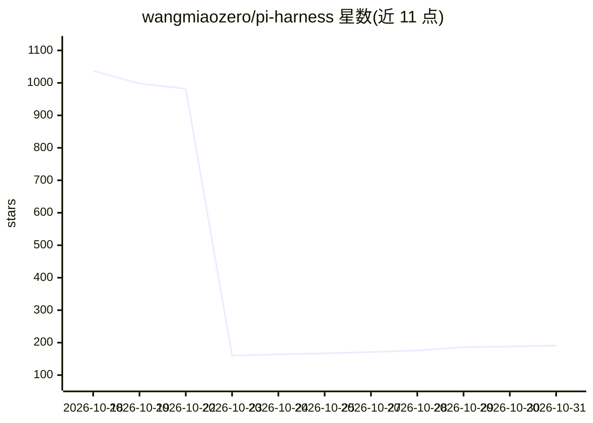

# wangmiaozero/pi-harness

⭐ 191 · TypeScript · AGPL-3.0 · 推送 2026-10-30 · [GitHub](https://github.com/wangmiaozero/pi-harness) · [官网](https://wangmiaozero.github.io/pi-harness-website/) · 个人维护

**为 Pi Coding Agent 提供可视化运维工作台的桌面应用**

基于 Electron 的桌面应用，将 Pi Coding Agent 嵌入可视化工作区：管理会话、项目、文件、Git、模型与 Skills；新增运行追踪（Runs/Trace/Replay/Run Compare）、评估、工具策略与预算、检查点与故障恢复、多 Agent 团队与任务 DAG 编排等运维能力。Pi 会话与配置保持兼容，可继续在桌面应用外使用 Pi。社区发布版捆绑 Pi、Node.js 与 npm，提供 macOS/Windows/Linux 安装包；macOS 包为 Ad-hoc 签名，Windows 安装包未签名。

## 筛选速览

| 维度 | 判定 | 备注 |
|---|---|---|
| AI 角色 | `ai-ecosystem` | LLM/agent 周边工具 |
| 许可风险 | `viral` | AGPL-3.0 |
| 部署形态 | `desktop` | 安装包/桌面程序 |
| 模型依赖 | — | README 未给出锁定关系 |
| 硬件要求 | — | 无带数字的原话,不猜 |
| 安装摩擦 | `low` | 无编译、无系统依赖或容器化 |
| 成熟度 | — | 结构信号不足 |

## 能力要点

- 继承 Pi Coding Agent 全部能力并提供可视化会话/模型/Skills 管理
- Runs、Trace、Replay、Run Compare 等运行观测与评估能力
- 工具策略、按次运行预算、检查点与恢复机制
- 多 Agent 团队、任务 DAG、Worktree 隔离与评审门

## 适用场景

- 在桌面端统一管理 Pi 编码会话、文件与 Git
- 观测和回放 Agent 运行并做回归评估
- 编排多个 Agent 协作完成带依赖关系的任务
- 聚合浏览 Claude Code/Codex/Cursor 等工具的本地对话历史

## 场景标签

`编码 Agent` `多智能体` `LLM 可观测性` · 领域:Agent 开发

## 证据(README 行号)

> L31: Pi-Harness brings Pi Coding Agent into a desktop workspace for macOS, Windows, and Linux. Manage conversations, pro
> L33: Native Pi runs the agent. Your Pi sessions, configuration, tools, Skills, and extensions remain compatible with Pi,
> L37: Pi-Harness is the operational superset of Pi Coding Agent: native Pi capabilities form the foundation, with observa

## 星数曲线

2026-10-18 1,037 → 2026-10-31 191（-846）

---
*卡片 v1 · prompt 1.4 · 生成 2026-10-21 · 置信度 high · 依据 README sha `4dc50a53ca5c` · [字段定义](../../DATASET.md)*
