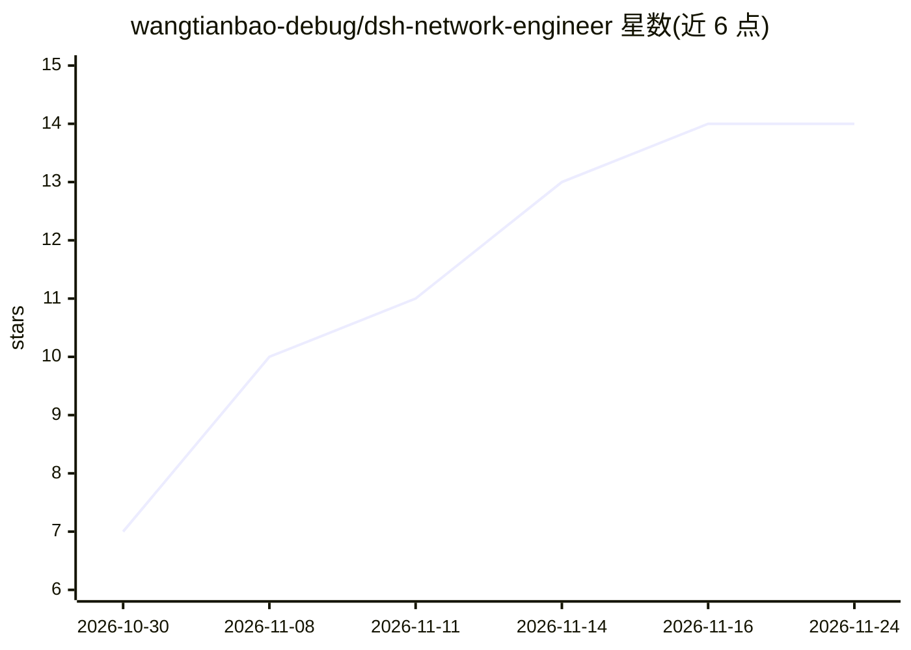

# wangtianbao-debug/dsh-network-engineer

⭐ 14 · JavaScript · MIT · 推送 2026-10-24 · [GitHub](https://github.com/wangtianbao-debug/dsh-network-engineer) · 个人维护 · 中文 README

**面向网络工程师的命令知识库插件：五厂商命令对照与高危提醒**

DeepSeek Harness 插件，分发一个「网络工程师助手」预设 Agent 及 40 篇结构化命令文档，覆盖思科、华为、新华三、锐捷、迪普五厂商，每厂商 8 个主题（系统管理/VLAN/接口/链路聚合/静态路由/OSPF/ACL/远程管理与诊断）。Agent 先查内置知识库，未覆盖内容联网检索官方文档并注明来源；reboot/format 等高危命令自动附风险提示与维护窗口提醒。仅回答网络工程主题。通过插件市场、DSH CLI 或手动放入 profile 安装。限制：迪普部分公开资料有限，标注 verified: medium。

## 筛选速览

| 维度 | 判定 | 备注 |
|---|---|---|
| AI 角色 | `ai-knowledge` | 知识聚合/清单类 |
| 许可风险 | `permissive` | MIT |
| 部署形态 | `None` |  |
| 模型依赖 | locked-api |  |
| 硬件要求 | — | 无带数字的原话,不猜 |
| 安装摩擦 | `low` | 无编译、无系统依赖或容器化 |
| 成熟度 | — | 结构信号不足 |

## 能力要点

- 五厂商各 8 主题共 40 篇结构化命令文档，含 YAML frontmatter 与命令速查表
- 跨厂商命令对照与路由优先级差异（华为 preference vs 思科 AD）内置于提示词
- 高危命令自动附 ⚠️ 风险提示、备份建议与维护窗口提醒
- 知识库未覆盖内容联网检索官方文档并注明来源，禁止编造命令

## 适用场景

- 查某厂商交换机的具体配置命令与视图
- 把一种厂商的配置翻译成另一种厂商的等价命令
- 执行重启、格式化等操作前获取风险提示与备份建议

## 场景标签

 · 领域:网络工程/知识库

## 证据(README 行号)

> L3: **English** — A DeepSeek Harness plugin that ships a standalone "网络工程师助手" (Network Engineer Assistant) agent preset 
> L8: - **内置知识库（40 篇）**：每厂商 8 主题（系统管理 / VLAN 与二层 / 接口 / 链路聚合 / 静态路由 / OSPF / ACL / 远程管理与诊断），以技能 `network-command-kb` 形式随插件

## 星数曲线

2026-10-30 7 → 2026-11-24 14（+7）

---
*卡片 v1 · prompt 1.4 · 生成 2026-11-18 · 置信度 high · 依据 README sha `560422d71554` · [字段定义](../../DATASET.md)*
