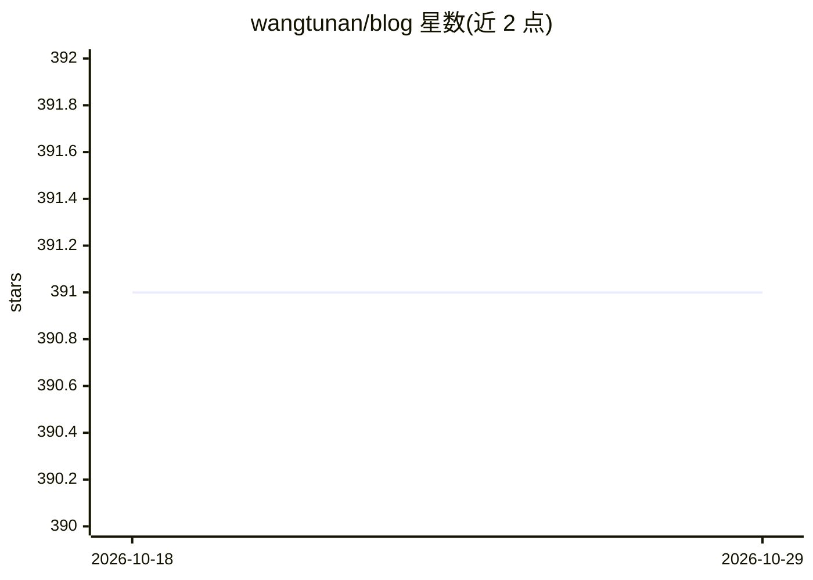

# wangtunan/blog

⭐ 391 · Shell · 推送 2026-03-13 · [GitHub](https://github.com/wangtunan/blog) · 个人维护 · 中文 README

**个人技术博客：前端、算法与 LLM 学习笔记**

基于 VuePress 的个人博客仓库，内容以目录形式组织，涵盖 LLM（RAG 基础、Agent 基础）、Python、前端面试、JavaScript/Vue 源码分析、数据结构与 LeetCode 刷题、打包工具（Webpack/Rollup/Vite）、TypeScript、SASS、自动化测试及 VuePress 使用笔记。面向读者提供学习笔记类内容，站点托管于 GitHub Pages。

## 筛选速览

| 维度 | 判定 | 备注 |
|---|---|---|
| AI 角色 | `ai-knowledge` | 知识聚合/清单类 |
| 许可风险 | `none` | — |
| 部署形态 | `None` |  |
| 模型依赖 | — | README 未给出锁定关系 |
| 硬件要求 | — | 无带数字的原话,不猜 |
| 安装摩擦 | `low` | 无编译、无系统依赖或容器化 |
| 成熟度 | — | 结构信号不足 |

## 能力要点

- 覆盖 LLM/RAG/Agent 基础的学习笔记
- Vue2/Vue3 源码分析系列
- 前端工程化笔记：Webpack/Rollup/Vite/TypeScript/SASS
- LeetCode 刷题与数据结构算法记录

## 适用场景

- 查阅前端与 Vue 源码学习笔记
- 了解 RAG 与 Agent 的入门内容
- 参考 LeetCode 刷题与面试准备资料

## 场景标签

`教程课程` · 领域:学习与行业

## 证据(README 行号)

> L6: ## LLM
> L7: * RAG基础
> L8: * Agent基础

## 星数曲线

2026-10-18 391 → 2026-10-29 391（+0）

---
*卡片 v1 · prompt 1.4 · 生成 2026-10-21 · 置信度 high · 依据 README sha `56c0bad3d243` · [字段定义](../../DATASET.md)*
