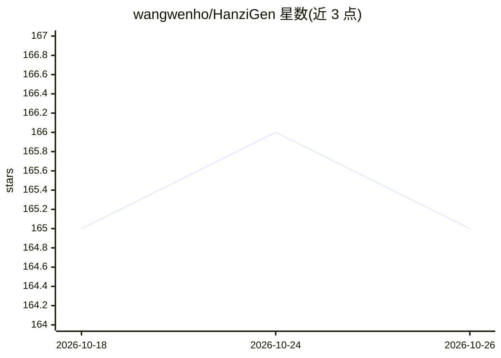

# wangwenho/HanziGen

⭐ 165 · Python · Apache-2.0 · 推送 2026-09-09 · [GitHub](https://github.com/wangwenho/HanziGen) · [官网](https://deepwiki.com/wangwenho/HanziGen) · 个人维护 · 中文 README

**漢字字型生成與補全系統：為缺字字型生成風格一致字形**

ICCE-Taiwan 2026 論文〈HanziGen〉官方實作，以潛在擴散模型（VQ-VAE + U-Net 兩階段訓練）生成缺失漢字字形，供字型設計師加速開發與補全。流程覆蓋字型漢字覆蓋率分析（jf7000/Unihan 字集）、字形圖像資料集準備、字集劃分、VQ-VAE 與 LDM 訓練及 LPIPS 評估。限制：非通用生成模型，每種目標字型需獨立訓練；不提供字型檔案與權重檔案；需自備 NVIDIA 顯示卡（至少 4 GB VRAM）。以 Python 腳本形式提供 Linux/Windows 使用流程。

## 筛选速览

| 维度 | 判定 | 备注 |
|---|---|---|
| AI 角色 | `ai-native` | 本体是模型或模型工具 |
| 许可风险 | `permissive` | Apache-2.0 |
| 部署形态 | `None` |  |
| 模型依赖 | — | README 未给出锁定关系 |
| 硬件要求 | `gpu-8g` | |
| 安装摩擦 | `medium` | 含编译或系统依赖之一 |
| 成熟度 | — | 结构信号不足 |

## 能力要点

- VQ-VAE + U-Net 兩階段訓練的潛在擴散模型字形生成
- jf7000 與 Unihan 字集覆蓋率分析與缺失字集產生
- 僅需 4 GB VRAM NVIDIA 顯示卡即可訓練與推論，支援 512×512 以上解析度
- 以參考字型（Jigmo 系列）結構引導生成風格一致字形

## 适用场景

- 補全字型中缺失的漢字字形，減少手工繪製工作量
- 分析自有字型對 jf7000/Unihan 字集的覆蓋情況
- 針對特定風格字型訓練專屬字形生成模型

## 场景标签

`图像生成` · 领域:内容生成

## 证据(README 行号)

> L16: 本專案為論文〈HanziGen: Supervised High-Fidelity Chinese Font Generation via Latent Diffusion Models〉之官方實作，該論文已發表於 2026 IE
> L27: 本專案採用潛在擴散模型（Latent Diffusion Model, LDM）作為圖像生成核心。透過兩階段訓練策略，模型能有效降低運算成本，並學習目標字型的風格特徵，隨後藉由參考字型的結構引導，生成風格一致的缺失字形圖像。
> L45: 本專案採用的潛在擴散模型由向量量化自編碼器（VQ-VAE）與 U-Net 兩大核心組件構成。VQ-VAE 負責將高解析度的字形圖像壓縮至離散的潛在空間，以完整保留字體的風格與結構特徵。隨後，U-Net 於此空間中執行加噪與去噪流程

## 星数曲线

2026-10-18 165 → 2026-10-26 165（+0）

---
*卡片 v1 · prompt 1.4 · 生成 2026-10-22 · 置信度 high · 依据 README sha `fc842c5270a2` · [字段定义](../../DATASET.md)*
